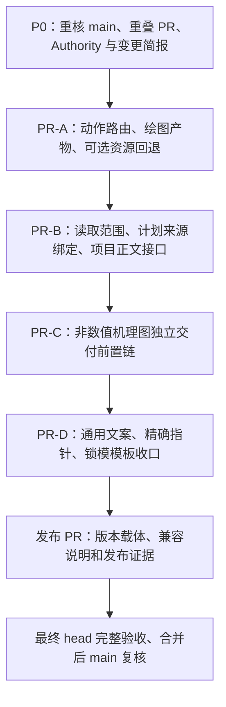

**mathmodel-skill 11 项问题完整修复计划（实施跟踪）**

编写日期：2026-11-05（Asia/Shanghai）  
状态：用户已授权推送计划并实施。计划先单独提交，随后逐项复核和实现；未取得最终 head 的正式验证前，不宣称修复验收完成。  
计划目标：修复已确认的 11 类问题，使用户意图、适用规则、读取来源、后端产物和交付门禁在同一次调用中保持一致，并用行为回归证明修复成立。

本文件最初在仓库外形成，经用户授权后纳入仓库。下述原始计划保留为实施依据，实际调整和完成证据统一记入文末。用户项目和真实数值证据不属于本次仓库修改范围。

**0. 基线、依据和编号**

| 项目 | 本计划采用的事实 |
|---|---|
| 仓库 | [Vexushi1/mathmodel-skill](https://github.com/Vexushi1/mathmodel-skill) |
| 审计与编写基线 | `e48e4654cf3460a6a4b9785b0eee6877df9ea257` |
| 当前发布版本 | `v10.26.3` |
| 当前 main 核对 | 编写本计划时仍为上述 commit |
| 开放 PR | 本次查询结果为空；开始实施时重新检查 |
| 审查报告 | 本聊天前序只读审查；问题、基线及复现摘要已在本计划列明 |
| 复现摘要 | 前序只读审查输出；实现中以提交的可复现行为测试作为回归依据 |
| 实施治理 | [SKILL_CHANGE_GOVERNANCE.md](https://github.com/Vexushi1/mathmodel-skill/blob/e48e4654cf3460a6a4b9785b0eee6877df9ea257/SKILL_CHANGE_GOVERNANCE.md)、同 commit 的 `AGENTS.md` 与 `core/bootstrap.yaml` |

问题编号与审计报告一致：

| 编号 | 问题 | 修复后的必要结果 |
|---|---|---|
| I01 | 审稿动作被载体关键词覆盖 | 审查 Word/LaTeX 进入 review；只读要求不会产生可执行的写入计划 |
| I02 | Python 绘图请求无法识别 | 常见 Python 绘图表达进入 figures，且不被误识别为数值求解 |
| I03 | Python 项目仍返回 MATLAB 产物角色 | resolver、读取计划与同步器使用同一个已选绘图后端及条件产物 |
| I04 | 选读遗漏后端选择段 | 当前适用的绘图后端规则进入必要读取范围 |
| I05 | 旧计划可与新 Authority 混读 | 计划版本、来源 commit、Authority 与阶段选择的一致性在返回正文前核验 |
| I06 | 项目来源缺少读取接口 | 明确项目根、状态快照和文件身份后，可只读提取框架、状态与绘图源码 |
| I07 | 通用入口仍有 MATLAB-only 残留 | 通用规则使用双后端语义；MATLAB 专用实现保持自己的有效说明 |
| I08 | 下游引用混入说明文字 | 两个实际 YAML 指针可精确解析，说明文字与路径分离 |
| I09 | 非数值机理图被数值门禁阻断 | 有足够当前模型证据时可独立交付非数值机理图；结果图的数值门仍完整 |
| I10 | 可选 Pack 缺失未回退 | 声明为可选的竞赛资源缺失时明确回退，必需 Authority 缺失仍阻断 |
| I11 | 锁模小模板身份术语过时 | 小模板与当前结构化身份合同一致，legacy hash 保持只读兼容 |

对证据作以下精确处理：

- I05 不是“读取器直接宣布整个阶段或 gate 通过”。现有完整字段只描述单个来源范围；应修复的是旧选择计划未被拒绝。
- I06 是统一读取接口缺口，不能据此推断项目文件在普通文件工具中也无法读取。
- I08 至少涉及 `downstream_contract.solve_scripts` 和 `analysis_scripts` 两个字段。
- 进一步核对发现，现有 `lint_skill.py` 明确支持 `ordered_slots+activation` 这类复合语义指针。不得把它当作坏 YAML key 批量改掉；先尊重现有解析语法及消费方式。
- `6.2.3` 等独立配置格式版本，以及 project state、workbook、SIB、B1/B2/C1/C2 等协议版本，不因 Skill 发布号不同而构成缺陷。

**1. “顺畅运行”的验收定义**

修复完成须同时满足以下条件：

1. 用户明确提出审查时，动作不会被 Word、LaTeX、Python、MATLAB 等载体或语言词覆盖。
2. 用户明确限制只读时，计划不会要求修改被审对象、同步项目状态或执行其他写入动作。
3. 当前项目选定的求解后端和绘图后端分别恢复；两者独立，不逐问混选，也不由语言词擅自迁移项目。
4. 当前适用正文能被取得，版本、commit、状态及文件身份能被核对，缺段和过期计划能被识别。
5. 同一调用中的产物角色、文件路径、读取来源和实际 gate 要求相互一致。
6. 非数值机理图、数值结果图、项目级预处理图具有正确前置条件，混合场景保留真实依赖。
7. 缺少可选资源时有可解释回退；缺少必需规则或证据时有准确阻断，不能以“回退成功”冒充正式交付通过。
8. 11 条问题逐条闭合，相关反例和兼容场景通过，最终远端 CI、生成物及合并后 main 验收完成。

修复不改变以下已有资格边界：Human Model Approval、accepted 工作簿、主数值有效性、Analysis Necessity Gate、Figure 人工语义/视觉批准、论文审查、编译证明和提交包验证仍各自独立。读取成功不能替代其中任何一项。

**2. 修改顺序与 PR 安排**

建议按四个单主题修复 PR、一个发布 PR 串行实施。每个修复 PR 都同步修改其直接 Authority、消费者、最低必要用法和行为测试；最后一组只负责剩余的通用文案及模板清理，不能把前面 PR 的接口说明故意留到最后。



| 阶段 | 主问题 | 主要交付 | 进入下一阶段的条件 |
|---|---|---|---|
| P0 | 全部 | 当前基线、消费者清单、变更简报、验收台账 | 基线和单一事实源明确；无未处理重叠写入 |
| PR-A | I01、I02、I03、I10 | 正确动作路由、后端产物投影及可选资源回退 | 专项和该 PR 最终 head 正式检查通过，合并后 main 复核 |
| PR-B | I04、I05、I06 | 正文范围补齐、计划身份核验、项目来源只读接口 | 过期计划、项目来源、分块与状态漂移测试通过 |
| PR-C | I09 | 独立机制图交付范围及各消费者一致适配 | 无数值模型案例可交付；结果图反例仍被正确阻断 |
| PR-D | I07、I08、I11 | 活动调用、模板与指针的一致性闭合 | 活动入口扫尾及跨层综合回归通过 |
| 发布 PR | 全部 | 发布号、Changelog、迁移/重取计划说明、完整证据 | 最终版本、tag、生成物和正式 CI 一致 |

实施原则：

- 每个 PR 使用独立分支和明确的执行上下文，遵守仓库“一次聊天一个明确分支”的规则；本轮不创建分支或聊天。
- 串行合并；后续分支基于已复核的最新 main，不在多个未合并分支中同时修改同一契约。
- 每个 PR 写明变更主题、等级、目标版本、Authority、预计文件、兼容性、验证和回滚方式。
- 单个 PR 若超过 20 个活动文件，按治理要求说明分组职责和无法进一步独立拆分的原因。PR-D 的通用入口、预处理交接及模板修改均服务同一后端语义，应按组解释，避免无关格式化。
- 源码与自动生成提交形成新的最终 head 后重新验收，不沿用旧 head 的 PASS。
- 发现计划之外的独立问题，先记入后续问题清单；仅纳入实现本计划不可缺少的直接适配。

**3. 单一事实源与实现职责**

| 事实 | 唯一规则位置/现有实现入口 | 本次处理方式 |
|---|---|---|
| 动作、载体及路由边界 | `core/workflow_router.yaml`；`resolve_workflow.py`、`runtime_assurance.py` | 在现有推断链定义动作/载体关系，两个 resolver 复用 |
| 有效产物及目录 | `core/output_contract.yaml`、`core/module_manifest.yaml` | 由一套后端/条件投影取得有效角色，避免 resolver 和 sync 各自维护新映射 |
| 绘图后端与脚本定位 | `scripts/plot_backend.py` | 复用现有 inspect/resolve；必要时在该模块提取纯投影函数 |
| 正文选择与来源身份 | `core/runtime_assurance_contract.yaml#reading_plan`；`reading_plan.py`、`read_stage.py` | 增加可靠来源绑定及项目来源分支，仍只返回正文 |
| 写作阶段 | `core/writing_runtime_contract.yaml` | 更新必要 selector；消费者检查当前阶段声明，不另建阶段注册表 |
| 交付范围及门禁 | `core/output_contract.yaml#project_sync`、router/manifest | 单独表达机制图交付范围，并适配全部实际 scope 消费者 |
| 项目快照 | `ProjectStateSnapshot`、现有 read-set/事务工具 | 复用当前字节和 generation；不缓存资格、不由读取器自动恢复事务 |
| 锁模资格 | `core/model_approval_contract.yaml`、SIB 与当前框架 | 仅同步模板字段及术语，不新增审批机制 |
| 指针有效性 | `scripts/lint_skill.py` 的现有 fragment checker | 补充必要注册项和坏值反例，保留既有 JSON Pointer、复合语义指针语法 |
| 受管索引和 MANIFEST | `scripts/generate_indexes.py`、`refresh-generated` | 远端生成，禁止手改 |

**4. I01：审查动作、载体与只读约束**

根因：最高关键词长度得分把审阅动词与载体词放在同一竞争集合；“只审查”也未形成约束后续行动的有效边界。

拟修改：

1. 在现有 router 中声明审阅动作与论文载体的关系，记录实际命中和选择理由。
2. 无显式 intent 时，审稿/审阅/终审动作选择 review；Word/LaTeX 作为被审载体或上下文，不自动激活写作、清理或编译。
3. 增补“审查”等实际缺失表达。对否定词和对象范围作有限、确定性的处理，避免把“不审稿，生成 Word”识别为审阅。
4. 将“只审查、不修改”落实为计划的只读约束：终点为审查报告，不返回可执行的项目同步写入、论文改写或编译动作。
5. 显式 intent 的既有优先级继续保留；若显式写作 intent 与请求中的只读约束冲突，记录冲突并阻断写入资格，不静默执行。不能用 `assurance=pass` 掩盖冲突。
6. 用户明确提出“修改后终审”时保留其真实复合动作；不得把一切出现审稿词的请求都压缩为只读。
7. 旧 `infer_intents` 与 assured resolver 使用同一个关键词适用性与动作判定基础，差异仅保留在明确的兼容边界。

主要文件：

- `core/workflow_router.yaml`
- `core/runtime_assurance_contract.yaml`
- `scripts/resolve_workflow.py`
- `scripts/runtime_assurance.py`
- `scripts/resolve_runtime.py`
- `scripts/README.md`（接口与诊断说明）

必要验收：

- “终审 LaTeX 论文，只审查，不修改”“审稿 Word 论文”“请审查数学建模论文”均选 review。
- Word/LaTeX 审阅的终点不包含 docx_draft、latex_source、compiled_pdf 等生成任务。
- 只读计划没有可执行的 `--write` gate；只读解析和审查前后项目字节不变。
- “生成 Word 草稿”“编译 LaTeX”“不审稿，只生成 Word”仍选择正确写作/载体路线。
- “不修改模型，只调整图例”不能因局部否定变成全局只读审稿。
- 显式 intent 冲突、真正的多意图和 full_workflow 仍有可解释结果及原有批准/执行等待点。

**5. I02：Python 绘图自然语言入口**

拟修改：

1. 在 figures 的现有推断词中覆盖 `Python绘图`、`Python 绘图`、常见“用 Python 绘图”表述及大小写/合理空白变化。
2. 明确绘图语言与数值求解语言的区别；Python 或 MATLAB 单词本身不直接代表求解或绘图。
3. 核对已声明的 SCI/Nature 等能力发现用词与实际推断行为，补齐当前应支持的组合表达；仍由 Figure Authority 决定科学表达和配色。
4. 用户请求语言与项目已选绘图后端不一致时，记录冲突并导航已有后端决策流程，不替用户项目自动选值或迁移。

主要文件：`core/workflow_router.yaml`、`scripts/resolve_workflow.py`；如需要共用标准化则复用现有 helper。

必要验收：

- 审计中的三个 Python 绘图失败例转为 figures。
- `python 绘图`、合理空白形式和既有 MATLAB 请求均可用。
- “Python 主求解代码”仍是求解；“Python 绘图并审阅图表”保留真实动作边界。
- 不因语言词自动更改 `execution.solver_backend` 或 `plotting.backend`。

**6. I03：统一有效绘图产物投影**

根因：路由和 manifest 已声明 Python 投影，resolver 却继续消费静态 MATLAB 候选产物；条件式预处理产物也未完整过滤。

拟修改：

1. 明确区分候选产物清单与当前有效输出。现有声明继续作能力注册，最终计划按项目证据投影。
2. 通过现有 `plot_backend` 解析绘图后端；求解后端只决定求解入口，不能决定绘图语言。
3. 在最终边界解析和项目恢复后统一投影以下字段：`module_terminal_outputs`、`terminal_outputs`、`available_after_modules`、`available_after_plan` 以及依赖/缺件判断；`runtime_plan` 使用该有效结果。
4. Python 项目使用 `plot_scripts` 和条件式 `preprocessing_python_plot_script`；MATLAB 项目使用当前 MATLAB 角色，且两者互斥。
5. 仅 `preprocessing_decision=project_level` 激活项目级预处理图脚本/图产物；not_needed、question_local 不被判缺件。
6. 后端未选或预处理判定未知时保持未解决/条件状态，不把未确认的语言产物视为必交或已可用。
7. 历史 MATLAB 项目的只读/可写兼容继续按现有合同恢复；默认 assured 新项目不得因缺字段擅自采用 MATLAB。
8. 保持 legacy stateless resolver 已承诺的兼容投影，但明确其兼容边界；已提供当前项目后端证据时必须使用有效投影。
9. 使用共享纯函数避免 resolver 导入大型 sync 模块形成循环依赖，也避免两套角色映射继续漂移。

主要文件：

- `core/output_contract.yaml`
- `core/module_manifest.yaml`
- `core/workflow_router.yaml`
- `scripts/plot_backend.py`
- `scripts/resolve_workflow.py`
- `scripts/resolve_runtime.py`
- `scripts/sync_project.py`
- `scripts/runtime_assurance.py`、`scripts/reading_plan.py`（按实际产物消费关系适配）

必要验收：

- 求解后端 2 种 × 绘图后端 2 种 × 预处理判定 3 种，共 12 组；再覆盖 analysis required/not_required，形成 24 组便宜的元数据/契约组合测试。
- 四种 solver × plot 组合同时检查 resolver、读取来源和 sync 要求，不能只测 sync。
- Python 项目没有 MATLAB 必交角色；MATLAB 项目没有 Python 绘图必交角色。
- 基础三文件和条件式 03B 产物要求一致；not_required 不生成占位结果。
- 未选择后端、冲突后端、历史 MATLAB、原有 stateless 调用分别有明确结果。
- 全部测试解析元数据或使用合成 fixture，不执行真实用户数值任务。

**7. I04：补齐适用规则的正文范围**

拟修改：

1. 在 figure_style、figure_design、组合图形读取及 review profile 中加入真实后端选择段的 selector。
2. 同步检查写作 runtime 的 draft_semantic_review、final_review_and_delivery 中 Figure 选读；适用时也必须取得该段。
3. 用准确标题/声明式 selector 表达适用范围，不硬编码“第 6–12 行”，避免下次编辑又漏读。
4. 保留文档前言与父级适用语，不为修复遗漏恢复整个仓库的无差别预读。
5. 不因只画非数据驱动机理图而强制选择数值结果绘图后端；其适用性由 I09 的真实范围决定。
6. 自动导航从源配置生成，不能手改 stage_reading_guide。

主要文件：

- `core/workflow_router.yaml`
- `core/writing_runtime_contract.yaml`
- `modules/04_figure_evidence.md`（仅在适用性/标题结构确需澄清时）
- `scripts/reading_plan.py`（若需复用适用范围处理）
- 对应读取测试；导航由生成链更新

必要验收：

- 实际展开并读取所有 chunk 后，当前适用正文包含项目级唯一后端、两套模板入口和同扩展名边界。
- selector 返回 exact 但漏掉该规则时，回归必须失败。
- 未知/缺失标题继续按既有规则显式 fallback 或报错，不能返回空规则。
- 相关分支不提前加载无关求解、预处理或审批材料。

**8. I05：计划来源、版本和阶段选择绑定**

建议接口方向：在现有 reading_plan 中增加运行时观察到的来源上下文，复用现有 Authority fingerprint，不把同一组规则再复制到第二套注册表。以下是计划中的结构示意，尚未实现：

```yaml
reading_plan:
  schema_version: 1.2.0
  source_context:
    kind: git_checkout
    skill_version: "<current bootstrap version>"
    source_commit: "<observed 40-character commit>"
  authority_fingerprint: "<reuse existing structured fingerprint>"
```

字段最终名称以源合同定义为准；只有一个权威声明。commit 在运行时取得，不把提交自身 SHA 写回受其覆盖的源码。

拟修改：

1. producer 输出可靠来源上下文；reader 在选源/返回正文前检查 supported schema、Skill version、计划源 commit、调用指定 commit 和当前 checkout 一致。
2. 从当前 Authority 的规范来源列表重算 fingerprint，核对完整来源集合及摘要，不能只相信输入计划给出的 sources 列表或 hash 字符串。
3. 对写作阶段比较当前 canonical stage 声明，拒绝旧的 authoring_sequence/read_now；复用当前选择函数或规范化表示，避免在 reader 中另写一套路由。
4. 对 read_now/conditional 核对声明的选择器、范围、来源身份及 Review 三文件闭包；正文和选择来源的未提交改动都不能冒充选定 commit。
5. 旧计划、缺少可靠来源上下文、未知 schema 或失配时明确要求重新 resolve。由助手在可用工具和当前项目材料下重新取计划，不能要求用户日常运行 checker。
6. 重新 resolve 是一次新的当前事实解析，不能通过只改旧 YAML 的 version/commit/fingerprint 字段来“升级计划”。
7. 保留 `gate_status=not_executed_by_reader`；清楚区分单块、单来源累计覆盖和整个阶段资格。
8. GitHub-only 继续按固定 commit 取原文；没有 Git 身份的完整资源根保留现有可用解析/说明边界，但不能被新 reader 冒充已验证 checkout。
9. 项目状态变化还需 I06 的快照检查，不能仅凭 Skill commit 不变复用旧项目计划。

主要文件：

- `core/runtime_assurance_contract.yaml`
- `core/workflow_router.yaml`（reading_policy schema）
- `scripts/runtime_assurance.py`
- `scripts/resolve_runtime.py`
- `scripts/reading_plan.py`
- `scripts/read_stage.py`
- `scripts/README.md`

必要验收：

- 真实旧版计划或等价的两提交 Git fixture，在新 checkout 上被拒绝；覆盖“旧阶段 4 来源、新阶段 8 来源”的原始断点。
- 相同 Skill version 但不同 commit、不同 Authority 或不同阶段清单也不能混用。
- 只改计划 version、仅更新一个 fingerprint、缺字段、未知 schema、dirty source、缺 canonical Review 源分别失败。
- 新计划在对应 checkout 上成功读取，分块缺失、重叠、身份混用仍失败。
- 在旧 checkout 使用旧版本自己的工具保持原边界；不对旧项目批量回写“新版本已核验”状态。

**9. I06：项目来源正文接口**

拟采用显式区分 Skill 根与项目根的方案。现有 Skill-only 参数保持可用，新增可选项目参数及来源消歧参数，建议形式：

```text
python scripts/read_stage.py
  --root <Skill根>
  --plan <当前resolver.yaml>
  --source-commit <Skill的40位commit>
  --surface read_now
  --origin project
  --project-root <项目根>
  --path 模型论文框架.md
  --chunk-index 0
```

以上是未来 CLI 示意，不是本轮运行指令。

拟修改：

1. `extract`、`select_sources`、`source_chunks` 与 CLI 一起支持具体的 `origin=project` 来源。
2. 项目根必须与计划绑定的当前项目一致；使用现有 ProjectStateSnapshot，验证状态原始字节、generation 和当前来源文件 hash。
3. Skill 来源继续用选定 Skill commit 验证；项目来源使用项目快照与文件摘要验证。项目文件没有自己的 Git commit 时不能把 Skill commit 填成它的来源 commit。
4. 扩充分块 identity，使 Skill commit 身份和 project_snapshot 身份有明确类型；`validate_chunk_coverage` 按来源类型核对身份，不降低原 Skill 来源要求。
5. 以 origin + path + 相应根/快照身份定位来源。同名跨根文件不得混淆，绝对路径/越界路径/指向根外的符号链接不能通过。
6. 读取前后重检状态和被读文件；相同 generation 但原始字节变化也必须失效。存在未完成事务时继续报告 recovery_required，不隐式恢复或写日志。
7. 首批覆盖具体框架、项目状态和当前 qN_plot.py/.m；XLSX 等二进制事实源继续使用原工作簿接口，不伪装为正文文本。
8. 符号项目事实别名仅在已有明确映射与当前 scope 时解析；无法唯一定位的别名保留 unresolved，不补造事实。
9. 读取器只读，不更新框架同步状态、不刷新验证 hash、不批准模型或图片。

主要文件：

- `scripts/read_stage.py`
- `scripts/reading_plan.py`
- `scripts/runtime_assurance.py`
- `core/runtime_assurance_contract.yaml`
- `scripts/README.md`
- 现有 snapshot/read-set helper 作为复用对象，只有接口确需调整时修改

必要验收：

- 审计中的三个具体 project 来源可以通过统一接口分块读取。
- 缺 project-root、错误根、过期状态、同 generation 改字节、文件 hash 变化、跨根链接、pending transaction 均失败。
- Skill-only 调用、历史 MATLAB 项目来源和 Python 项目来源均正确。
- 任一 chunk 的来源身份改变或混合来源时累计覆盖失败；每次调用前后项目字节不变。
- 旧 plan 自动取新计划的说明由助手承担，不新增用户每日环境预检。

**10. I07：通用入口和双后端语义收口**

拟修改：

1. 以 Module 04、output contract 和现有后端定位 helper 为准统一通用术语，使用“当前选定绘图脚本”及后端条件路径。
2. 所有通用布局分别表达数值求解后端与绘图后端；Python 求解项目可以用 MATLAB 绘图，反之亦然。
3. 通用 Figure Contract 的 `MATLAB script` 字段改为后端中性的绘图入口字段，并保留旧模板字段的只读兼容说明。
4. 项目级预处理图按选定后端使用 data_process.py 或 data_process.m；两者受相同的只读证据、禁止重处理/重求解和人工审图边界约束。
5. Pack、README、入口只保留摘要与指向 Authority 的导航，不把每套硬规则完整复制到所有文档。
6. MATLAB 专用目录、MATLAB API 示例、历史兼容投影、Python 专用模板各自保持明确语言范围。
7. 修正 token 型测试的盲区，用真实项目的后端产物/读取/交付行为验证通用说明；仍保留历史 MATLAB 的正向覆盖。

优先修改文件：

- `PROJECT_INSTRUCTIONS.md`、`RUNTIME_ROUTER.md`
- `core/hsk_core_policy.md`
- `core/global_preprocessing_contract.yaml`
- `core/code_quality_contract.yaml`
- `core/workbook_schema.yaml`（通用读取/交接说明，不更改工作簿格式）
- `core/module_manifest.yaml`（gate 说明及中性角色）
- `modules/03_data_preprocessing.md`
- `packs/artifact/code.md`、`figure.md`、`review.md`、`full_submission.md`
- `templates/figure/result_figure_contract.md`
- `templates/writing/code_appendix_description.md`
- `templates/code/starter/README.md`、`templates/code/hsk_pipeline/README.md`

复核后按实际需要修改：

- `core/user_execution_contract.yaml`、`core/output_contract.yaml`
- `modules/04_figure_evidence.md`、`modules/03_result_analysis.md`
- `templates/figure/figure_plan.md`、`figure_paper_closure.md`
- `templates/review/result_manifest.yaml`、`result_analysis_check.md`
- `templates/model/model_paper_framework.md`
- `templates/plot/python/README.md`、`templates/matlab/README.md`
- `README.md`、`agents/openai.yaml`、活动 Skill 入口

必要验收：通用入口不再无条件要求 .m；Python/MATLAB 两个分支均可沿同一通用证据规则执行；既有 MATLAB 专用示例、历史脚本及 Figure 证明链保持可用。

**11. I08：精确引用和现有检查器补口**

拟修改：

1. 把 `core/global_preprocessing_contract.yaml#downstream_contract.solve_scripts` 与 `analysis_scripts` 的值改为可解析的 `core/output_contract.yaml#per_question.solver_scripts`，将用途和条件放入清楚分离的说明字段或注释。
2. 先确认这两个字段的实际消费者；若外部仍按字符串读取，保留字段类型，仅移动附加说明，不无故改成新对象结构。
3. 将该机器指针区域纳入现有 critical fragment 检查范围，增加字段值混入说明文字的失败例。
4. 保留现有 dotted path、JSON Pointer、动态占位和复合语义指针语法；不靠扩大正则排除范围让坏值绕过检查。
5. Python 函数导航和自然语言组合说明按实际用途区分，不将全部文案都强行解析为单一 YAML key。

主要文件：

- `core/global_preprocessing_contract.yaml`
- `scripts/lint_skill.py`
- `scripts/lint_skill_checks.py`（若现有通用检查需衔接）
- 现有仓库引用/卫生测试

必要验收：两个旧坏值会被检测；新值可定位；合法 `ordered_slots+activation`、`#/$defs/...` 和动态占位仍通过；历史 prose 不误报为当前机器指针。

**12. I09：非数值机理图独立交付链**

建议在现有 output contract 中增加独立的 `mechanism` 交付 scope，沿用已有 semantic governance 和 project_sync 工具，不新增第二套同步器或绕过 gate 的旁路。

拟修改：

1. 在 router 将明确的非数据驱动机制图路线指向该范围；manifest 的前置条件按图的真实证据类型区分。
2. 拆开 Figure Evidence 的非数值前置与数值工作簿前置，避免 graph closure 自动给独立机制图补出 solution_workbook。
3. 独立范围要求当前题意/模型依据、当前框架、Figure Contract/Spec、实际可编辑源、适用结构检查、真实渲染和人工语义/视觉审查；具体正式产物仍按原 Figure Authority。
4. 该范围不无条件要求主求解工作簿、主质量报告、03B 报告、qN_plot.*、数值求解后端或数据型预处理图入口。
5. 同时修改 resolver 的 scope 排序/组合、manifest 的 gate scope、sync 的 Python API/CLI allowlist、snapshot 中按 scope 强制数值文件的逻辑及相关检查说明。
6. 无关数值结果的缺失不阻断纯机制图；模型或机制依赖本身 stale/冲突仍必须处理。
7. 机制图含真实数值结果、统计量或工作簿依赖时保留原 accepted 数值资格。不能仅凭 .drawio 扩展名或路线名称豁免数值证据。
8. 混合机制图与结果图请求按两者真实依赖合并；不能用较宽松 scope 覆盖数值结果图。
9. 不改变项目持久 phase 或模型审批状态来凑通过；若能用运行时 delivery scope 完成，本次不增加项目状态 schema 字段。
10. 不自动批准图片；结构通过仍不等于语义或视觉通过。

主要文件：

- `core/workflow_router.yaml`
- `core/module_manifest.yaml`
- `core/output_contract.yaml`
- `modules/04_figure_evidence.md`
- `templates/figure/mechanism_contract.md`、`mechanism_qa.md`
- `scripts/resolve_workflow.py`
- `scripts/resolve_runtime.py`
- `scripts/sync_project.py`
- `scripts/project_snapshot.py`

必须检查并按消费情况适配：

- `scripts/execution_provenance.py`
- `scripts/runtime_assurance.py`
- `scripts/validate_project_state.py`
- `scripts/validate_model_paper_framework.py`
- `scripts/submission_requirements.py`
- `core/runtime_assurance_contract.yaml` 与 manifest 的 delivery_scopes
- 现有机制图源/结构检查器和 Figure 源证明消费者

必要验收：

- 只有已批准的当前模型、无求解工作簿的原复现，能够准备并验收真实非数值机制图，不出现 solution_workbook 缺件。
- 不会为了完成机制图而要求选择数值求解器、生成 qN_plot.* 或虚构 accepted 结果。
- stale 模型、缺 Spec/source/preview、结构错误、未人工审查的导出仍据实阻断正式批准。
- 结果图、预处理证据图、带工作簿数值的机制图、混合请求继续执行原数值证据门。
- 原 figures、latex、docx、submission 等 scope 的要求与 gate 顺序不被放宽。

**13. I10：可选竞赛资源回退**

拟修改：

1. 在现有竞赛资源选择链显式判断已知 profile 返回的可选 Pack 是否存在，并核对根内路径。
2. 可选 Pack 缺失时使用实际存在的通用 Pack；若竞赛 Pack 均缺失且该场景允许，直接采用必需的通用 Authority，不向 load_order 塞不存在路径。
3. 记录请求的竞赛、期望路径、实际 fallback、原因及未取得的专项规则；下游读取与产物计划使用实际有效资源。
4. 未知竞赛、已知 profile 无专项 Pack、专项 Pack 缺失、模板缺失的既有回退策略保持一致；不另造竞赛业务规则。
5. 必需 bootstrap/router/Authority 缺失、越界路径、损坏配置、权限/身份错误不被当作“可选缺失”吞掉。
6. 保留 profile 中已知且有效的官方规则，不因 Pack 缺失重写事实；缺失/未核验赛事规则也不得自动变成 verified。
7. 资源 fallback 不清除独立的 MANIFEST/安装完整性失败，更不能证明全部 Skill 资源已完整加载。
8. resolver、reading_plan、GitHub-only 导航对有效来源的说明一致。

主要文件：

- `scripts/resolve_workflow.py`
- `scripts/resolve_runtime.py`
- `scripts/reading_plan.py`
- `core/workflow_router.yaml`
- `scripts/README.md`
- `config/competition_profiles.yaml`（仅当需澄清可选性，不改赛事事实）

必要验收：原 missing cumcm.md 案例回退；专项完整时不降级；未知竞赛继续可用；必需源缺失、坏配置和越界资源继续失败；无官方规则时不产生“官方要求已核验”结论。

**14. I11：锁模片段模板同步**

拟修改：

1. 对照当前完整框架模板与 model approval contract，同步独立片段的结构化身份术语和必要数据项。
2. 明确当前 semantic revision、Semantic Identity Schema、当前/validated/approved semantic identity hash 的职责。
3. 将 legacy semantic/text hash 标为旧项目只读 provenance，避免把它当作新代码授权条件。
4. 片段只提供当前项目数据栏位与 Authority 引用，不复制完整审批规则，不从空白或 prose 生成 SIB、批准或 passed。
5. 保持活动索引可发现；若未来决定退休片段，应作为另一个有兼容说明的变更，本次优先修正现有片段。

主要文件：

- `templates/model/model_approval_section.md`
- `templates/model/model_paper_framework.md`（仅必要的字段一致性调整）
- `scripts/instantiate_model_paper_framework.py`（若实际引用该片段才改；目前未据此要求重写实例化器）
- 身份表面一致性/框架模板测试

必要验收：单独采用该片段与完整框架的身份术语一致；纯 legacy hash 仍不能通过当前主求解/预处理审批门；空模板不能产生批准。

**15. 计划修改文件总表**

下列为仓库相对路径，供后续分支和 PR 使用。列入“必查/条件修改”的文件不是本轮已修改文件；实施中依据实际消费者调整，不进行全仓库文字替换。

| 文件组 | 计划处理 | 对应问题 |
|---|---|---|
| `core/workflow_router.yaml` | 动作/载体、绘图词、输出投影、后端 selector、机制图 scope、资源回退声明 | I01–I05、I09、I10 |
| `core/module_manifest.yaml` | 实际产物消费、Figure 条件输入、scope 与 gate 说明 | I03、I07、I09 |
| `core/output_contract.yaml` | 单一产物投影及独立机制图范围 | I03、I07、I09 |
| `core/runtime_assurance_contract.yaml` | 动作约束、计划来源、项目快照和版本合同 | I01、I05、I06、I09 |
| `core/writing_runtime_contract.yaml` | 审阅阶段的必要 Figure 读取及发布载体 | I04、I05 |
| `scripts/runtime_assurance.py` | 动作推断、共享快照及来源核对 | I01、I05、I06 |
| `scripts/resolve_workflow.py` | 共享推断基础、有效产物、资源回退、scope | I01–I03、I09、I10 |
| `scripts/resolve_runtime.py` | 当前项目投影、只读冲突、来源上下文及有效 scope | I01、I03、I05、I09、I10 |
| `scripts/plot_backend.py` | 后端定位复用及纯产物投影 helper | I03 |
| `scripts/reading_plan.py` | 范围、计划身份、project 来源及有效资源 | I03–I06、I10 |
| `scripts/read_stage.py` | 旧计划拒绝、项目根/来源读取、分块身份 | I05、I06 |
| `scripts/sync_project.py` | 共享角色投影及机制图 scope 消费 | I03、I09 |
| `scripts/project_snapshot.py` | scope 对数值结果与图脚本要求的实际适配 | I09 |
| `scripts/lint_skill.py` | 现有关键指针检查纳入真实缺口 | I08 |
| `scripts/lint_skill_checks.py` | 按需衔接通用语义检查，避免 MATLAB-only 断言 | I07、I08 |
| `scripts/README.md` | producer/reader 用法、兼容、回退及重取计划说明 | I01、I05、I06、I10 |
| `core/hsk_core_policy.md` | 中性可视化硬边界；不复制阶段细则 | I07 |
| `core/global_preprocessing_contract.yaml` | 双绘图后端交接及两个精确指针 | I07、I08 |
| `core/code_quality_contract.yaml`、`core/workbook_schema.yaml` | 通用读取职责措辞；不改工作簿格式 | I07 |
| `modules/03_data_preprocessing.md`、`modules/04_figure_evidence.md` | 后端交接、适用性和机制图边界 | I04、I07、I09 |
| `PROJECT_INSTRUCTIONS.md`、`RUNTIME_ROUTER.md` | 当前有效计划与通用调用的双后端说明 | I03、I07 |
| `packs/artifact/{code,figure,review,full_submission}.md` | 各通用 consumer 摘要与目录示例 | I07 |
| `templates/figure/result_figure_contract.md` | 中性绘图入口和兼容字段说明 | I07 |
| `templates/figure/{mechanism_contract,mechanism_qa}.md` | 非数值机制图真实前置/验收 | I09 |
| `templates/writing/code_appendix_description.md` | 附录中的求解/绘图语言职责 | I07 |
| `templates/code/{starter,hsk_pipeline}/README.md` | 交接示例按已选绘图后端解释 | I07 |
| `templates/model/model_approval_section.md` | 当前结构化身份字段与旧 hash 边界 | I11 |
| 第 10、12 节的其余消费文件 | 必查；有真实适配需求才修改 | I07、I09 |
| `CHANGELOG.md`、发布源文件 | 登记实际变更、兼容说明和发布版本 | 全部 |
| 原有 CI 工作流 | 默认只复用；仅新增测试未被当前 targeted 调度覆盖时最小适配 | 验收 |

测试文件优先扩展现有行为测试：

| 范围 | 现有测试文件 |
|---|---|
| 意图、动作与载体 | `tests/test_router_contract.py`、`tests/test_v712_runtime_assurance.py`、`tests/test_v10182_paper_routing.py` |
| 后端及产物闭环 | `tests/test_project_plot_backend.py`、`tests/test_read_path_semantic_closure.py`、`tests/test_contract_closure.py` |
| 正文与阶段读取 | `tests/test_read_stage.py`、`tests/test_reading_plan.py`、`tests/test_reading_module06.py`、`tests/test_stage_reading_lifecycle.py` |
| 导航与来源 | `tests/test_stage_reading_guide_lifecycle.py`、`tests/test_reading_plan_evidence.py`、`tests/reading_plan_cases.py` |
| 原生项目快照/同步 | `tests/test_sync_project.py`、`tests/test_sync_project_source_read_set.py`、`tests/test_project_state_read_snapshot.py` |
| 机制图 | `tests/test_v830_editable_mechanism_diagram.py` |
| 资源回退/写作兼容 | `tests/test_v900_phase_g_competition_runtime.py` |
| 通用文案与指针 | `tests/test_repository_hygiene.py`、`tests/test_content_packs.py` |
| 模板与身份 | `tests/test_v900_semantic_identity_surface_closure.py`、`tests/test_v711_model_approval_gate.py`、`tests/test_schemas.py` |
| 发布与入口 | `tests/test_v752_entrypoint_parity.py`、`tests/test_v900_phase_i_release_carriers.py`、`tests/test_v900_phase_i_release_closure.py` |

仅在现有文件不能清楚承载新边界时，新增以下有独立行为职责的文件：

- `tests/test_read_stage_project_sources.py`：项目根、快照、来源类型与跨块一致性。
- `tests/test_mechanism_delivery_scope.py`：模型-only 机理图与数值反例。
- `tests/test_optional_competition_resources.py`：可选资源缺失与必需源失败的区别。
- `tests/test_runtime_consistency_end_to_end.py`：意图 → 计划 → 读取 → 产物 → scope/gate 的综合回归。

不为低影响措辞替换逐条建立镜像测试。新增测试必须能在修复前暴露对应行为缺陷，在修复后通过，并保留与之相反的有效场景。

**16. 生成文件、版本和冻结 fixture**

受管文件只由远端生成链更新：

- `core/stage_reading_guide.md`
- `SKILL_FILE_INDEX.md`
- `TEMPLATE_INDEX.md`
- `MANIFEST.sha256`
- 生成器管理的旧索引兼容指针
- `knowledge/case_memory/index.json` 若生成链实际产生差异，必须核对原因；本计划不更改案例语料

版本建议：

1. 最终聚合发布建议以 `v10.27.0` 为目标：本次包含向后兼容的新 reader CLI 和计划来源接口，按治理规则不能全部标为 docs 或纯 patch。
2. 这是计划目标，不是已预占或已发布版本。实施时若 main 已升级，以实际最新版本重新计算。
3. 四个修复 PR 参考仓库现有“行为修复后单独 release PR”的方式，分别登记变更等级和待发布范围；最终发布 PR 统一更新发布载体。中间 main 以 commit 标识开发状态，不宣称某个既有 tag 已包含新修复。
4. 发布载体至少核对 bootstrap、plugin metadata、两个 SKILL 入口、README、router、manifest、output contract、writing runtime、global policy 以及实际 lint 检测的活动 carrier。无发布号的导航文档只改必要说明。
5. reading_plan/reading_policy 从 1.1.0 到 1.2.0 的建议仅限该接口结构；runtime assurance 若新增合同字段，建议独立从 2.5.0 到 2.6.0，须以实际 diff 最终确认。
6. 计划不要求修改 project state 8.16.0、workbook 2.4.0、SIB、RUN_RECEIPT、A1/A2、B1/B2、C1/C2、D1/D2 等格式。若实施发现确需改持久格式，先补齐兼容设计与验收，不能顺手更号。
7. 受保护的历史 golden 不重写。对当前读取和产物行为的合法变化，使用清楚登记的新期望/精确 delta，保留历史断言；不靠降低断言、删除测试或加入笼统例外通过 CI。

**17. 必须覆盖的综合验收**

| 场景编号 | 场景 | 必须证明 |
|---|---|---|
| E01 | LaTeX 终审、只读 | review_report 路线；不写论文、不写项目状态 |
| E02 | Word 审稿、只读 | DOCX 作为载体；不生成草稿或 LaTeX 迁移任务 |
| E03 | 显式写作 intent 与只读约束冲突 | 有冲突说明，无可执行写入资格 |
| E04 | 真正写作/编译/修改后终审 | 保持被授权动作及原有有序门禁 |
| E05 | Python 绘图常见三例及空白/大小写 | 正确路由，项目后端不被暗改 |
| E06 | 2 solver × 2 plot × 3 preprocessing × 2 analysis | 24 组产物/读取/sync 元数据一致 |
| E07 | 新项目未选绘图后端 | 未解决状态明确，不伪装历史 MATLAB |
| E08 | 历史 MATLAB 项目 | 原脚本和合法历史兼容仍可用 |
| E09 | Figure style/design/review 真实分块 | 后端选择段实际进入适用正文 |
| E10 | 当前写作 draft/final review | 正确 canonical 来源闭包及必要 Figure 规则 |
| E11 | 旧版本计划 + 新 checkout | 返回正文前拒绝，并给出重新 resolve 路径 |
| E12 | 同版本不同 commit/Authority/stage | 不能依靠发布号相同混读 |
| E13 | Dirty source 或伪造更新单字段 | 来源一致性失败，不能报告有效完整读取 |
| E14 | 缺块、重叠、跨来源身份混用 | coverage 明确失败，缺口准确 |
| E15 | 框架/state/qN_plot.py 三项目来源 | 正确项目根和快照下可读，始终只读 |
| E16 | generation 相同但字节变、文件读取中变 | 必须失效，不能命中旧缓存 |
| E17 | 错根、越界、外部 symlink、pending transaction | 保持原安全与只读边界 |
| E18 | 模型-only 的真实非数值机理图 | 不要求求解工作簿或 qN_plot.*；仍要求真实图形审查 |
| E19 | 机制图含数值来源或混合结果图 | accepted 数值和必要结果分析门不被豁免 |
| E20 | 缺机理图 Spec/source/preview 或模型 stale | 不因“机制图 scope”而自动通过 |
| E21 | 可选竞赛 Pack 缺失 | 使用存在的通用规则，记录未取得的专项范围 |
| E22 | 必需 Authority 缺失/坏配置/越界路径 | 仍阻断；不将所有错误吞成 fallback |
| E23 | 两个坏 YAML 指针及合法复合指针 | 坏值失败、合法语法通过，无历史误报 |
| E24 | 单独复制锁模片段 | 当前身份术语一致；legacy hash 不授权新代码 |
| E25 | 框架、状态、工作簿和 Figure 的资格关系 | 不新增批准、accepted、渲染通过或数学正确性结论 |
| E26 | 全部 25 路由、11 写作阶段、5 条件分支 | 原有暂停边界、scope 与门禁顺序无非预期改变 |

综合测试使用有明确性质的合成数据；缺陷在元数据层时不运行数值 solver。正式仓库验证仍由 GitHub 完成，不能把本地小复现或解析检查当作正式验收。

为防止本次修复影响已存在的可选协议，还需在最终完整回归中保留：

- A2 conformance 交付/回执及上游 read-set 绑定。
- B1 accepted 来源与算术核验，B2 LaTeX/DOCX source/Figure 链及结构化否证回退。
- C1/C2 scoped review receipt 和 submission 只读重验边界。
- D1/D2 案例检索默认不加载和显式检索边界。
- Model Approval 的结构化身份、数值执行全精度及用户所有权。
- Python Figure、MATLAB 数值、LaTeX/PDF 和 submission provenance 的原有专项。

**18. GitHub 实施、验收和发布流程**

以下为后续执行流程，不在本轮触发：

1. 重新读取 main 的 bootstrap、治理规范及相关 Authority，检查重叠 PR。
2. 以本计划对应的单主题范围形成当前修改简报，记录实际目标版本和预计文件。
3. 从最新已复核 main 建立独立分支，先落下能复现行为缺陷的必要用例，再实现修复；文案变更使用与其影响相称的检查。
4. 只提交源文件和测试，推送分支，建立 draft PR。
5. 等待 GitHub `refresh-generated` 更新受管文件；无差异也记录最终 head。核对 bot 仅改变预期生成物。
6. 在开发阶段执行受影响的远端专项与基础静态/生成检查；不重复无差别调度整套回归。
7. 冻结 ready PR，在最终 source/bot head 上完成正式完整验证：
   - Static contract lint、Generated file contract；
   - Windows Python 3.10 的 4 文件分片和 `Python 3.10` 汇总；
   - Windows Python 3.14 的 4 文件分片和 `Windows Python 3.14` 汇总；
   - 两个版本的 Python Figure rendering；
   - Windows MATLAB R2024b native contract；
   - 受影响的 LaTeX 模板及 Production LaTeX attestation；
   - 适用的 Optimization baseline。
8. 核对每个正式 job 的实际 checkout commit、版本、完整 discovery ID 集合、退出状态与产物；不得将缺失、失败或跳过的必需分片计为通过。
9. 确认 11 项中的本 PR 范围已经有失败例、成功例和兼容例；审阅 source diff、生成 diff 以及版本/接口说明。
10. 全部必需检查通过后按授权范围合并，记录合并 SHA，复核该 main 的正式 CI。
11. 按四组修复顺序推进；任一 head 或基础分支变化都重算影响面并验证新最终 head。
12. 发布 PR 汇总已合并修复、兼容说明和版本载体。实际 Tag/Release 仅在届时授权范围内执行，且指向完成正式验收的实际发布 commit。
13. 最终报告给出每个 PR、最终 head、合并 SHA、workflow run、各正式门、合并后 main 与发布标签的对应关系；尚未完成的检查保持未完成。

不修改 required check 名称、正式 Python 平台矩阵或测试全集以缩短流程；不手工更新 MANIFEST 让检查通过；真实用户的本地全精度数值执行职责保持不变。

**19. 兼容、重取计划和回滚**

| 对象 | 兼容/回滚安排 |
|---|---|
| 旧 MATLAB 项目 | 不自动迁移；保持现有脚本、旧角色和历史事实的明确兼容 |
| 已选 Python 绘图项目 | 修正计划和通用说明，不重算已验收工作簿 |
| 旧 resolver 计划 | 新 reader 要求重新 resolve；旧 checkout 的旧工具仍保留其原边界 |
| 项目来源 | 增加只读读取能力，不修改用户文件、状态 generation 或批准记录 |
| 模型/数值批准 | 不倒填或续签；升级 Skill 不等于项目批准或执行重新验收 |
| 旧输出消费者 | 只在明确 legacy 边界保留旧投影；当前 Python 证据不能继续报成 MATLAB 必交 |
| 无 Git 根或 GitHub-only | 保留清楚的身份可核验范围及原文读取方式，不虚构 pinned checkout |
| 机制图 scope | 作为运行时范围增加，不通过重写 project phase 或删除数值门实现 |
| 回滚源代码 | 使用对应主题 revert PR，关联原 PR，远端重生成并重新验收 |
| 回滚版本/计划 | 保留已发布 tag；需要修复时发后续版本，不移动既有 tag，不伪造旧计划 currentness |
| 回滚项目数据 | 本计划不迁移用户数据，不能通过恢复旧状态文件撤销真实模型/数值变更 |

应作为整体回滚来源绑定或 scope 消费者，不能仅回退 schema 字段/CLI allowlist 留下半套接口。若回滚会降低新引入的来源校验，应明确保持失败关闭和重新取计划路径，不用旧 PASS 维持表面可用。

**20. 最终关闭台账**

实际修改集中在 [PR #301](https://github.com/Vexushi1/mathmodel-skill/pull/301)，下表记录实现落点；正式验证以该 PR 最新 head 的 GitHub Checks 为准。

| 问题 | 实施 PR / commit | 专项用例与反例 | 最终 head CI | 文档/模板一致 | 状态 |
|---|---|---|---|---|---|
| I01 | router review_action_policy；两个 resolver 共用动作判定；review Pack 移除固定写命令 | 审阅 Word/LaTeX/绘图；否定审阅；显式编辑冲突 | PR 最新 Checks | 已核对直接消费者 | 已实现，待正式验收 |
| I02 | router figures infer_keywords 与空白归一 | Python绘图、Python 绘图、双空格、MATLAB绘图 | PR 最新 Checks | 已同步 | 已实现，待正式验收 |
| I03 | plot_backend.project_figure_roles；resolver/sync 复用 | 24 组元数据组合；真实计划 Python/MATLAB 两分支 | PR 最新 Checks | 已同步通用交接 | 已实现，待正式验收 |
| I04 | Module 04 后端规则改为适用前言 | figures/review 实际返回正文包含 plotting.backend | PR 最新 Checks | 原 selector 保留 | 已实现，待正式验收 |
| I05 | read_stage.verify_plan_context；Authority 指纹纳入读取/投影实现 | 旧版本、旧指纹、旧 schema、改动阶段列表拒绝 | PR 最新 Checks | 重取计划说明已补 | 已实现，待正式验收 |
| I06 | read_stage --project-root/--origin；项目快照与文件 hash | 框架/状态/绘图源码分块；无根、同 generation 改字节拒绝 | PR 最新 Checks | CLI/覆盖身份已补 | 已实现，待正式验收 |
| I07 | 全局入口、预处理、绘图/LaTeX/审阅 Pack 与活动模板 | 原 content/semantic drift/历史格式保护回归 | PR 最新 Checks | 专用 MATLAB 实现保留 | 已实现，待正式验收 |
| I08 | global_preprocessing 两个下游指针；lint 注册该 Authority | 精确 fragment 解析与原坏指针检查 | PR 最新 Checks | 说明改为注释 | 已实现，待正式验收 |
| I09 | mechanism scope、模块输入输出 profile、现有 sync 只读分支 | current model-only 通过；数值依赖/未审预览拒绝；混合范围保留数值门 | PR 最新 Checks | Module/Manifest/Output/CLI/lint 已适配 | 已实现，待正式验收 |
| I10 | available_competition_pack | 缺失专用 Pack 回退；越界路径拒绝 | PR 最新 Checks | 回退原因显式返回 | 已实现，待正式验收 |
| I11 | model_approval_section 当前结构化身份字段 | 当前/validated/approved identity 及旧格式保护回归 | PR 最新 Checks | legacy 只读说明 | 已实现，待正式验收 |

只有全部问题闭合、跨层综合回归与正式最终 head 检查通过、生成物核对完毕且合并后 main 复核完成，才能宣称 main 修复完成。源码实现记录与 PR/合并状态分开；本次没有创建发布 tag 或 Release。


**21. 实施调整与实际证据（2026-11-05 开始）**

- 最新 main 重新核对为 e48e4654，当前没有开放 PR。已读取该 main 的 bootstrap、AGENTS 与治理规范。
- 用户授权把本计划推送到仓库并实施，明确允许在实施时纠正方案。
- 遵守当前 AGENTS 的单分支、单主题 PR 要求，原四组串行 PR 调整为同一 `fix/runtime-consistency-11` 分支上的分阶段提交。统一主题为“当前运行计划、正文来源、后端产物与交付前置链一致性”。相关消费者共享 router/manifest/output/reading Authorities，需要在同一最终 head 上验证。
- 新增可选 CLI 参数和兼容交付范围，按 minor 准备 `10.27.0`，同步全部活动 release carriers；独立协议号保持原值。未发布 tag 或 Release。
- I05 不增加另一套 source_context 或强制 schema 升级：现有 plan.version、reading/assurance authority_fingerprint、当前 canonical writing stages 和选定 commit 已能表达必要绑定。将直接影响读取和产物选择的五个实现文件加入已有指纹，防止“配置未变但解释器已变”的旧计划继续使用。
- I04 把后端规则放入既有选读机制自动保留的适用前言，保留冻结的 stage ID、顺序和 selector；没有扩大为默认整文件读取。
- I09 使用现有同步器的只读 mechanism 分支，不增设独立 checker 或写状态流程。模块候选输出及 gate 输出同时收窄，避免没有生成的数值脚本或 sync_report 被列为本次交付。含 result_evidence 的 draw.io 图必须回到 figures scope。
- I03 的 24 组覆盖是求解/绘图后端、预处理及 analysis disposition 的纯角色组合，不声称执行了 24 次数值求解或人工审图；两个实际项目读取分支另测。
- I07 复核中发现 review Pack 的固定 submission --write 命令及 LaTeX/机理图检查模板中的 MATLAB-only 指令，同属本次直接消费者，已一并修正。
- Windows 完整回归发现 I06 的本机反斜杠路径与 CLI 正斜杠参数未匹配；读取器改为按当前平台 Path 语义比较路径，保留原来源、项目根、状态快照及文件哈希核验，不把别的平台字面反斜杠擅自当作本机分隔符。
- I01 的边界复核覆盖生成审查报告、审阅后的同步动作，以及“求解评分模型”的数学请求；评分相关审阅识别收窄到论文/代码/报告语境，避免把模型中的评分对象当成只读审阅动作。
- 本次不改变用户项目或持久工作簿格式，不迁移求解/绘图后端，不替代 Human Approval、accepted workbook 或图片人工审阅。
- 正式验收只使用 GitHub 的最终 head 证据；受管文件交由 refresh-generated。开发阶段先专项，冻结后完整验证。
- 历史保护不通过重置 Golden 或删除断言处理：工作簿契约仅逆向还原两处经过审查的交接措辞后检查原 blob hash；P2 历史对比用 `tests/fixtures/runtime_consistency_v10270_projection.yaml` 公开记录精确指纹扩展、条件产物及 mechanism 差异，其他字段仍须逐一相等。新增反例确认无关源 hash、顺序、门禁、产物和 scope 的变化不会被抹掉。
- 开发诊断：新行为复现、已有读取器、图表/路由/内容保护等专项已运行；19 个既有 P2 场景在登记本次必要差异后没有未登记变化。它们不替代远端正式检查。
- 开发阶段曾发现并修正 lint 的旧 scope allowlist、旧 MATLAB-only 测试断言及工作簿措辞逆投影位置；生成文件在源码 head 上暂时落后须等待 refresh-generated，不能借手工改 hash 通过。
- 首轮完整 Windows 回归补齐了四处旧 MATLAB-only 文案断言（整体标题与 Contract 参数范围）；仅同步双后端表述，原标题约束、参数范围约束及其他断言保留。
- 当前状态：11 项源码及直接消费者已实现，PR #301 跟踪生成提交、Windows 专项、冻结后的完整双版本分片、MATLAB/Python Figure/LaTeX 与适用 Optimization baseline。最终 head、工作流与合并结果以 PR 描述及 GitHub Checks 的实际记录为准。
