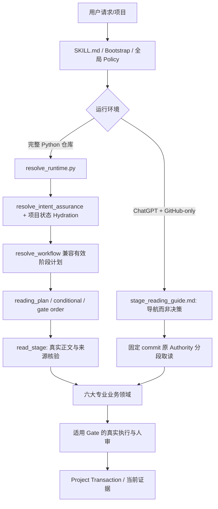

# HSK 数学建模 Skill v10.27.0：运行时行为完整性与非退化减重专项修改计划（R1 审计修订版）

> **文件性质：R1 审计修订版（planning-only）**。本文件不属于 Runtime Authority，不授权模型批准、数值求解、状态迁移或 Gate PASS。本次 G0 仅获授权提交计划文档；G1—G6 仍须分别获得实施授权、重新确认基线并履行各自的单主题 PR。  
> **编制日期：2026-11-12**。仓库：[`Vexushi1/mathmodel-skill`](https://github.com/Vexushi1/mathmodel-skill)。冻结研究基线：`main@5b7828ec0ae41dc97c095cd62d43f889596bd646`，正式 Release `v10.27.0`。本次核对开放 PR 为 0。  
> **历史证据**：同一 commit 的 [HSK Skill CI #42047036699](https://github.com/Vexushi1/mathmodel-skill/actions/runs/42047036699)、[Optimization baseline #42047174879](https://github.com/Vexushi1/mathmodel-skill/actions/runs/42047174879)、[Generated metadata #42047036733](https://github.com/Vexushi1/mathmodel-skill/actions/runs/42047036733) 成功。`main.protected=false` 属独立仓库治理事项，不在本次 Runtime 代码重构范围。  
> **相关上游资料**：`docs/runtime_router_and_gate_simplification_refactor_plan.md`（v10.23.2 已闭合）、`docs/final_acceptance_traceability_matrix.md`（50 场景、保留 PARTIAL/PENDING_MANUAL）、`docs/stage_reading_execution_refactor_plan.md`、本轮三份 v10.27.0 只读审计。不能将旧计划的历史进度重新标为待实现，也不能把旧 CI 成功视为新 PR 的验收结果。

> **R1 审计结论（2026-11-12）**：对 `main@5b7828ec0ae41dc97c095cd62d43f889596bd646` 的实际源码及历史测试复核后，原计划须修正三个前置问题：**A01 历史基线比较器不接受不同的 case/driver 哈希**；**A02 默认 Assured 与 Legacy Router 的既有多意图/双载体行为不同且有回归保护**；**A03 请求动作、selected intents 和可执行写入权限不能画等号**。另补充 B01—B06 六个实施约束。原 v10.23.2 路由简化计划已完成，不重复施工。
> **证据说明**：仓库存在 `tests/fixtures/skill_optimization_cases.yaml` 的 **16** 个历史 Optimization 场景，与 `tests/reading_plan_cases.py` 的 **19** 个 P2 读集场景，它们不是同一测试集。本版本仅修订计划，没有重新运行新反例、性能基准或真实赛题，不能声明 F01 已复现或性能已改善。

---

## 0. 执行决议与修改简报

| 字段 | 决议 |
|---|---|
| 修改主题 | 运行时意图完整性、规则读取成本和有证据的内部重复实现收束 |
| 当前版本 / 冻结基线 | `v10.27.0` / `5b7828ec0ae41dc97c095cd62d43f889596bd646` |
| 目标版本 | **暂不预设**。计划本身按 docs-only，不升级版本；每个实现 PR 按真实行为差异分别评估 patch/minor，破坏兼容时先给迁移方案并按 major 治理，不得预设 v10.28.0 |
| 第一直接目标 | 复现或排除自然语言多动作漏分派；同时证明显式任务、否定句和只读审查不会误触发写入 |
| 第二直接目标 | 分别度量 ChatGPT + GitHub-only 与完整 Python Resolver 环境的实际成本，再减少不必要的来源读取、重复验证或计划输出 |
| 第三直接目标 | 对已证明同构的纯逻辑进行小范围归并，减少重复维护与语义漂移，保持所有事实源和持久化事务原样 |
| 明确不做 | 不推翻六大建模业务模块，不改变数学公式/数值容差/工作簿验收，不新增平行 Router/审批系统/状态机，不基于文件大小删除功能，不自动开启 A1/A2/B1/B2/C1，不以算法更快替代科研质量 |
| 兼容目标 | 旧 `resolve_workflow` CLI、现有 `resolve_runtime` 输出、`reading_plan`、`read_stage.extract`、既有项目状态及 legacy read-only 边界在默认情况下兼容；行为变更只允许记入批准的差异清单 |
| 初步成果 | 旧基线保护、独立新基线、外部动作 oracle、实际成本报告、单主题改造 PR 与非退化证据 |
| 三通道基线 | L：历史 P1/Legacy 16 例；P：P2 阅读 19 例；N：同一新驱动在固定 v10.27.0 与候选 worktree 的独立比较 |
| 行为差异授权 | 本 G0 docs-only PR **不批准任何业务行为修改**；后续逐 PR 记录精确 `approved_behavior_deltas` 并独立审核，不因计划获准便默许旧测试改预期 |
| 首要停止点 | G1A 比较协议/兼容基线 PASS → G1B oracle/成本报告 → 有实际反例且获授权后才可进入 G2 |
| 计划建议路径 | `docs/v10_27_runtime_nonregression_optimization_plan.md`（仅在获准写入 GitHub 后按仓库治理用 docs 分支和 PR 提交） |
| 禁止手改 | `MANIFEST.sha256`、生成索引、旧兼容指针、历史审批/工作簿哈希及所有用户真实项目文件 |

### 0.1 前置停止条件

实施前必须重新读取 **当前** `main` 的 `core/bootstrap.yaml`、`SKILL_CHANGE_GOVERNANCE.md`、所有受影响 Authority；重新检查当前 SHA、Release、所有开放 PR 与重叠分支。如果 HEAD 漂移，先重做影响分析及基线，不得沿用本计划的历史 SHA 直接开发。若已存在相同修复的最新 PR 或缺陷被新版本消除，应终止相应工作包，不重复施工。

### 0.2 证据与声明规则

- **S（源码证据）**：当前固定 SHA 的活动函数/契约可以定位的行为；不等同于运行后的 bug 复现。
- **T（测试定义）**：现有测试名称/断言确有覆盖；本计划没有声称重新执行。
- **L（远端运行证据）**：GitHub Actions 的精确提交、作业与工件；不能挪用旧 head。
- **H（假设或静态推演）**：待新增实际正反例；没有复现不得标为“已确认运行错误”。
- **M（真实科学验收）**：真实赛题的题意、模型、数值、科研图与论文人工判断，当前尚无新的完整复演。

---

## 1. 已冻结的现行架构：业务流程与控制流程不能混同

### 1.1 两条运行环境

**执行环境 A**：完整代码路径可以给出当前 effective plan、暂停状态、Gate 顺序。`load_order` 是兼容资源清单，`reading_plan.read_now` 是计划读取范围，二者均不是“已读证明”。

**执行环境 B**：GitHub-only 依靠 `core/stage_reading_guide.md` 找到原始 Authority；指南不能生成项目的真实 `effective plan`，不能证明执行了 `resolve_runtime.py`、`read_stage.py` 或 Gate。此环境应测量实际工具取读次数、文本字节、补读和任务完成率，不能将本地 YAML 微基准冒充使用体验收益。

### 1.2 路由/读取/业务/验收职责表

| 层/组件 | 唯一职责 | 主要消费者 | 不允许的越权 |
|---|---|---|---|
| `core/bootstrap.yaml` | 入口、权威指针、启动硬约束 | 所有入口 | 复制专业正文或取代 Route |
| `core/hsk_core_policy.md` | 全局不变量 | 全部业务领域 | 改写细分 Authority |
| `core/workflow_router.yaml` | 25 个意图、运行片段、按动作取读策略、Gate 顺序来源 | Resolver、Reading Plan | 证明模型/数值正确 |
| `core/module_manifest.yaml` | 11 个模块和输入输出/产物图、12 类工具声明 | 兼容 Resolver、闭包、检查器 | 将候选输出当作已 accepted |
| `scripts/resolve_runtime.py` | 默认入口：意图+状态恢复+有效计划+Assurance | Assistant、Stage Reader | 运行用户数值代码或改项目状态 |
| `scripts/resolve_workflow.py` | legacy/无状态兼容计划与阶段边界 | Assured Resolver、旧 CLI | 作为第二个并列任务路由标准 |
| `scripts/runtime_assurance.py` | 意图来源、状态读取、artifact assurance、依赖合同闭包、Authority 指纹 | Resolver、Reader | 代替实际审批、质量门或数值验收 |
| `scripts/reading_plan.py` | 根据已定路由和验证事实得到 `read_now/conditional`、原文范围 | Stage Reader、Assistant | 把“计划”冒充“正文已消费” |
| `scripts/read_stage.py` | 校验 commit/SHA/snapshot/范围/分块并返回实际文本 | Assistant | 将源码文本读取提升为已审批/已交付 |
| `core/writing_runtime_contract.yaml` | 11 个 CUMCM 写作子阶段和 preflight | LaTeX 写作/Review | 建立第二套数学模型或结果真相 |
| Module 01–06 | 完成审题—建模—求解与检验—图证—论文—终审 | 各阶段 | 重新发明 Router/状态机制 |
| `core/project_state.schema.yaml` + `core/state_transition_contract.yaml` | 机器状态形状/typed stale 语义 | 状态引擎、检查器、同步器 | 把纯展示变化当模型变化 |
| `scripts/project_transaction.py` | 有锁/读集/原子提交/恢复写入 | 合法状态写入者 | 写入绕过代际检查 |
| `core/output_contract.yaml` | 目录与作用域、正式交付条件 | Sync、包检查 | 用文件存在证明数值正确 |

### 1.3 五个运行片段和六大研究领域

`model_approval_pending`、`preprocessing`、`primary_execution`、`analysis_execution`、`full_workflow_resume` 是有效计划截断/恢复片段，不是新增五个专业模型。六大研究领域是 Module 01、02、03P/03A/03B、04、05A–D、06；不能为减少 Router 而删除这些专业边界。

### 1.4 当前项目三类核心事实源和第四类论文证据

| 事实 | 事实源 | 失效依据 |
|---|---|---|
| 数学语义与论文框架 | 当前 `模型论文框架.md`；机器身份以 State 为准 | 语义修订、SIB/依赖变更 |
| 当前机器资格 | `state/project_state.yaml` + Schema/Transition | revision、generation、typed stale |
| 真实数值 | Accepted workbooks + 原 RUN_RECEIPT + 原始数据/执行 bundle | SHA、数据或模型变化、数值质量资格 |
| 论文可交付事实 | 当前 TeX/Bib/图、LaTeX audit、compile proof、PDF、review/package report | 来源 bundle、PDF 与编译证明一致性 |

任何“只读消费旧 accepted 结果”的例外仍须符合 `core/output_contract.yaml#project_sync.source_identity_lifecycle`；它不是授权用改过的源码伪称已重新运行。

---

## 2. 已有优化：本计划禁止重复开发

1. v10.23.2 旧版 Router/Gate 简化计划已合并验收：可选比赛资源回退、混合旧图+新图路径、同名 Gate 在一次计划中的有序去重、历史 accepted 结果只读消费等。没有新反例不得重开“删除同名 Gate”项目。
2. `scripts/safe_yaml.py` 已有 `CSafeLoader`（可用时）和按真实内容的有界进程内解析缓存；不开发第二套 YAML 缓存，不缓存批准/Gate PASS/可变项目事实。
3. `SourceReader` 已有单次 build 的原始字节缓存；可测量同次选择器解析复用，但不能称“此前完全没有缓存”。
4. Module 06 Draft/Final 审查已模块化；不再强制合并成单文件，也不能用局部审查缩读取消正式整稿覆盖。
5. 03B 是 Analysis Necessity Gate 激活的独立深化，不是每问必须生成五件套；`not_required` 不是稳健性已验证。
6. Python/MATLAB 数值后端与 Python/MATLAB 绘图后端已经分离；应继续通过现有项目根决策与角色投影，无需新增语言 Router。
7. 完整 Python CI 已分片；不因想让修改更快而删测试/缩减 Windows 3.10、3.14 正式回归。

---

## 3. 问题/机会台账：逐项定性，不抢跑解决方案

| ID | 性质 | 位置 / 当前源码事实 | 要验证的问题 | 优先度 | 直接处理建议 |
|---|---|---|---|---|---|
| F01 | S+H，正确性高风险 | Assured `resolve_intent_assurance` 只取最高特异性候选；Legacy `infer_intents` 可保留多个命中且有 `full_workflow` 例外；双载体行为已有回归断言 | 明确双动作是否漏分派？否定/只读/载体提及能否正确排除？ | **P0** | G1A 冻结兼容，G1B 独立 oracle，真正复现后才修复 |
| F02 | S，成本候选 | `reading_plan._scope()` 遇到多意图时返回 `full` | 完整独立动作能否构造完整必要读集的去重并集？ | P1 高风险 | F01 行为完整性通过后才开发 |
| F03 | S，成本候选 | Assurance 不通过/缺图批准/语义风险时可能回退完整资源 | 阻断任务是否能只读诊断所需权威而维持相同 fail-closed？ | P2 高风险 | 需区分真正语义变更与纯证据缺失 |
| F04 | S，呈现冗余 | 机器计划保留 `load_order`、`runtime_plan`、`reading_plan`、部分重复指纹和写作序列 | 能否将给模型看的计划视图从机器完整计划派生，以减少无关元数据？ | P1 | 增量只读展示接口，不改机器计划 |
| F05 | S，工具成本候选 | `read_stage.extract` 每次检查 checkout/Authority/Git source/项目 snapshot | 同一次不可变请求下能否安全批量取回多个完整片段？ | P1 | 新增可选批量接口，保留单条 CLI |
| F06 | S，解析候选 | `resolve_runtime` 再调用会重新读取 Bootstrap/Router/Manifest 的兼容 Resolver | 复用传参是否实际节省 I/O/时间？ | P2 | 先测量；`safe_yaml` 已有缓存 |
| F07 | S，解析候选 | 同一 YAML/Markdown 可以多次构造范围选择器/AST | 源内容一致时是否可复用同次选择器索引？ | P2 | 按当前字节身份缓存索引，失败全文回退 |
| F08 | S，维护一致性 | `sync_project.py` 与 `validate_semantic_governance.py` 有相似的片段 stale 闭包 | 两者对所有边界输入是否完全一致？ | P1 | 差分测试通过才归并纯函数 |
| F09 | H，局部审稿优化 | Review Profile 与 Final Review 共用多类内容权威 | 明确局部只读审稿能否保留必要语义后降低读取？ | P3 | 只在明确定义局部载体/范围时试点 |
| F10 | S，测量缺口 | 当前 Optimization 的 `actual_read_tokens=null`；GitHub-only 缺使用端成本追踪 | 实际工具字节、调用次数、完整性、延迟如何记录？ | **P0** | 先建无副作用观测基线 |
| F11 | 待测，兼容负担 | 历史 MATLAB artifact、legacy API、旧回执及 schema compat | 是否有“无活动消费者”的兼容路径？ | 暂缓 | 不并入本次精简；若证实独立 major/migration |

**F01 示例仅为静态推演**：当前词表可能对“修改问题二图表，并调整 LaTeX 论文中的文字说明”赋 `latex` 更高分，致 `figures` 未进入 selected intents。真实修复前必须在 fixed SHA 的 `resolve_runtime` 新增正反例，不得直接宣称生产环境已复现。也不得粗暴改变为“所有出现过的关键词都选中”：文本提及/否定/引用目标不必然构成执行要求。

---

## 4. 非退化定义：规则不减 ≠ 每次都必须全量读

### 4.1 将“动作、有效计划、执行资格”分成三套独立断言

**测试专用 expected-action oracle**：对每个合成请求，在运行被测 Resolver 之前独立标注 `positive_actions`（确实要求）、`negative_actions`（明确禁止）、`informational_mentions`（背景/被审查对象）、`targets/carriers`（目标及载体）、`dependencies/conflicts`（依赖及互斥）。不能让 Router 现有关键词评分或 candidate 输出反向生成标准答案；含义争议的样例先标 `needs_adjudication`。

**有效计划投影**：以 `B=(selected_intents,modules,delivery_scope,pause_state,user_execution_boundary,solver_backend,plot_backend,ordered_pre_delivery_gates,terminal_outputs,missing_prerequisites,artifact_qualification,stale_effects,source_read_contract)` 比较 baseline/candidate。每个要求的动作都应有 `dispatched`、`explicitly_deferred_or_blocked`、`unsupported_with_reason` 或错误 `accidentally_executable` 的可核验处置。**合法等待或阻断不是漏路由；出现路由名称不代表动作完成。** 如果多个动作无法安全组成单一有效计划，保持原有暂停和 Gate，返回非执行性的顺序工作项，不建第二套调度器。

**真实执行资格**：无论动作被选中与否，都不能跳过当前模型双挑战/人工批准、用户 full-fidelity 运行、accepted workbook、source/snapshot/stale、正式 Gate 与只读限制。所有负向动作必须满足 `negative_actions ∩ executable_write_actions = ∅`。只读报告不能把任何状态改变成 passed。

**差异规则**：性能-only PR 必须保持业务向量等价；已复现的正确性修复可以产生**仅限批准范围**的行为差异，逐项记录 case、字段路径、旧值、新值、原因、批准人/批准范围、测试证据和回滚方法。源代码 SHA/Authority fingerprint 因合法变更而变化，属于来源身份事实，须另行核验，不能机械地视为行为退化，也不能因哈希必然改变就放过资格和 Gate 漂移。任何未登记的差异为阻断。

---

### 4.2 权威读取覆盖与事务完整性

把每个**已确定适用动作**需要的权威范围记作 `R(action, state)`，其必需读取闭包为 `R*`；本次实际完整返回的原文范围记作 `D`。可做窄读的必要条件是：`R* ⊆ D`，且当前 snapshot/Authority fingerprint/commit/source SHA 与片段覆盖均一致。未来新增读取器只可改变获取方法，不能改变资格。

- `read_now` 计划、`conditional` 尚未触发、`load_order` 文件列表均不能冒充已读正文；未知条件是 unresolved，不是 false。
- 路径失效、YAML alias/重复键、标题不唯一、源码 SHA 漂移、dirty checkout、旧计划、缺块/截断、project snapshot/代际漂移必须维持 fail-closed / 全文保守回退的当前语义。
- 所有合法项目写入继续走 `project_transaction.py` 的锁、read-set、generation、原子提交与恢复；一次只读诊断不产生状态写入。

### 4.3 硬性保留的科学与工程边界

1. **模型层**：Problem Contract → Condition→Consequence/可证明化简 → 最小充分主模型 + `0..N` comparator → Complexity Sanity → 两轮独立 Model Challenge → 当前 SIB 的明确 Human Model Approval。历史 `semantic_hash` 不授权新代码。
2. **数据/数值层**：`preprocessing_decision` 的三个状态；项目根数值后端唯一选项；任务代码只交付给用户 full-fidelity 运行；主工作簿原始回执/源码/数据/质量核验；03A 和必要 03B 不能合并。
3. **图表层**：正式图表后端与数值后端独立、图证绑定 accepted 工作簿、科学图形选择与人工视觉/语义批准；机制图的合法非数值独立范围不丢失。
4. **论文层**：Template Manifest 与普通写作 Protocol 分工；逐问 Writing Preflight、最终章节交接、草稿 Review → AI Cleanup → LaTeX Audit/Compile → Final Review 的语义顺序不变；机器编译证明不替代科学审稿。
5. **交付层**：使用真实所选 Delivery Scope 和当届 verified 赛规；最新 PDF/源码/图片/工作簿 SHA 及 package manifest 验证；不允许旧数据/旧 CI 证明当前交付。
6. **治理层**：不删当前正式 CI、历史合法只读兼容，不手改生成文件，不直接写 main，修改等级据实际兼容性裁决。

---

## 5. G0：计划落库与回归证据准备（docs-only，可单独停止）

**目的**：把本计划正式纳入仓库维护轨迹，但仍不改变任何业务代码。此步骤不是对所有后续 PR 的自动授权。

**前置**：用户明确要求将计划写入仓库；当前 SHA/PR/Governance 重新核对。

**建议文件**：仅 `docs/v10_27_runtime_nonregression_optimization_plan.md`；受管索引由 GitHub 自动生成，绝不直接编辑。

**实施顺序**：
1. 创建 `docs/v10-27-runtime-nonregression-plan` 独立分支；首次提交仅含本计划。
2. 逐段检查引用的 Router、Authority、旧闭环记录是否真实；如果 HEAD 已更新，添加“原基线与新的实施基线”的差异说明，而不是覆盖历史证据。
3. 由 GitHub refresh-generated 形成最终 PR head；完成 docs-only 所要求的基础 CI、生成文件检查，再审阅合并。
4. 合并后仍需用户单独授权开始 G1 及后续实施工作；不得因为计划合并便自动修改算法/路由。

**STOP**：与已存在 PR 发生重叠、引用失效、计划描述成新的业务 Authority、生成文件需手改时停止。

---

## 6. G1：比较协议先行，随后建立行为 oracle 与真实成本基线

**G1 必须分成 G1A（兼容比较协议）与 G1B（行为/成本观测）；不先改路由。** G1A 未通过，不启动 G1B/G2。

### 6.1 G1A：原有两套历史基线必须原样保护

| 通道 | 现行来源 | 必须保持的合同 | 新方案 |
|---|---|---|---|
| **L：Legacy/P1** | `tests/fixtures/skill_optimization_cases.yaml`（16 例），`tests/optimization_baseline.py`，既有 Optimization workflow | 当前 `cases_sha256`、`measurement_driver_sha256`、Authority 指纹及字节对照约束；原正式测量驱动/历史批准证据 | 不改旧用例和驱动；旧报告按原流程独立回归 |
| **P：P2 Reading** | `tests/reading_plan_cases.py`（19 例），`tests/reading_plan_evidence.py` 及历史 `approved_*` projection | 既有合法窄读/Full fallback 反例和精确受保护差异 | 不通过全局放宽 approved projection 实现新优化 |
| **N：新增 v10.27.0→Candidate** | 待建立的单独 case corpus、单独测量驱动 | 以 **同一份新 corpus/driver** 分别在 `5b7828ec` baseline 和 candidate worktree 执行，并固定输入快照 | 逐字段比较业务行为、读取覆盖与成本；批准差异显式登记 |

**严禁**：将新增 G1 用例塞进旧 16/19 文件后直接和旧 driver 结果互比；不满足 `cases_sha256`/`measurement_driver_sha256` 就把旧比较器改成宽松通过；把源码合法更改带来的 Authority SHA 变化一律判为业务错误，或者一律豁免实际 Gate/资格差异。

N 通道建议包含 `baseline_commit, candidate_commit, driver_sha256, cases_sha256, fixture_sha256, runtime_environment, behavior_before/after, field_diff, approved_behavior_deltas, unapproved_behavior_deltas, authority_fingerprint_before/after, source_read_coverage, measured_costs`。改变新测量器自身时，应在**同一新协议版本**下重新测量基线与候选，不能把不可比数据拼成回归。

现有 `.github/workflows/optimization-baseline.yml` 使用独立历史 worktree 和 `tests/reading_plan_evidence.py` 比较器：除非明确需要新增 N 通道 CI，默认**不改**现有 workflow 调度、正式 check 名称、P1/ P2 比较断言。新基线对照仅作增量，不能替代旧正式 Optimization CI。

**G1A PASS**：旧 L/P 独立维持；新 N 能在相同输入、相同 driver 下复现两边数据；Authority 改动以来源身份与业务语义两个维度分别核查。G1A 不代表 F01 已复现，也不证明新模型质量。

### 6.2 G1B：语义独立的动作标注与生命周期处置

由测试审核者预先标注四类：
- **独立动作**：图表修改＋论文说明、旧图美化＋新图、检验＋本问写作；两个动作均有处置，但可以因依赖分阶段执行。
- **互斥载体**：Word＋LaTeX 草稿属于当前受保护的 Assured/Legacy 分歧用例；本计划默认保持既有 Assured 最佳特异性选择、Legacy 多路由行为。不自动改变双载体产品语义。
- **只读/否定/背景提及**：只审稿不编辑、图表不改模型、代码只被引用；这些词不得触发相应写入。
- **显式 CLI/API**：`figures`/`review` 等当前显式 intent 优先；自然语言描述不能扩张执行范围，冲突仍 fail-closed。

每例标记 `positive_actions, negative_actions, informational_mentions, targets/carriers, dependencies, expected_dispositions`，再对实际 `selected_intents, modules, pause_state, ordered_gates, terminal_outputs, missing_prerequisites` 比较。真正要求的动作应当被分派，或明确给出合法的阻断/延期/不支持理由。**即使选中了两个 intent，也要验证组合后每个动作的 Gate/暂停/副作用，不是只比较 intent 名单。**

关键反例：`只修改图不改论文`、`审稿 Word 但不修改`、`只给建模思路不生成代码`、`explicit figures 但正文提及 full_solution`、`无 current SIB`、`主结果 accepted 且 03B not_required`、`项目数据/源码 SHA 漂移`、`Python×MATLAB 求解/绘图 2×2`、`旧 plan/dirty source`、`局部 Review 不可生成整稿 PASS`。

### 6.3 成本测量必须按环境与成功/失败路径分层

1. **完整 Python 环境**：相同硬件/版本、冷/热启动分别记录 Resolver 与 Reader P50/P95、文件读取、YAML/选择器解析、Git 子进程、源哈希和内存；不得用单次微基准推断整体响应。
2. **返回正文**：区分 `planned_read_bytes`、`actual_returned_bytes`、`read_now` 与实际触发的 `conditional`、去重/重复字节、缺失块和补读。Reader 报告的 `complete` 不等于宿主确实完整接收。
3. **ChatGPT + GitHub-only**：固定 commit 的调用次数、可见内容范围、重复取读、截断、来源变化和任务完成状态。不能假装运行了 Python Resolver，也不能用 GitHub Actions runner 时间代替用户延迟。
4. **统计分层**：常规成功任务与故意 stale/无审批/冲突的异常任务分开。P2 的 19 例中多数 Full 是故意的反例，不是自然请求 Full 频率；`actual_read_tokens` 无真实遥测继续记 `NOT_MEASURED`，不自行换算真实 Token 节约。

**G1B STOP**：标准动作标签由 candidate 自动生成、观测产生写入/授权变化、泄露私人项目全文、不同驱动数据混比。**G1B PASS**：独立 oracle 被审定，L/P/N 证据可追踪，受保护字段/审批边界未改变，成本度量范围明确；这不自动授权 G2 修改。

---

## 7. G2：仅修复真实复现的动作缺陷，受保护兼容行为不默认改变

**准入**：G1A/G1B 已通过，本工作包取得独立授权；当前 `tests/test_v10182_paper_routing.py` 等旧断言保持生效。

**施工步骤**：
1. 在 v10.27.0 baseline 用独立 oracle 实际运行 Assured 与 Legacy，保存候选词、分数、最终 intent、完整有效计划及 Gate/pause；若只是可解释的合法暂停，不判为漏分派。
2. 把请求明确划分为**独立动作、互斥载体、否定/背景/只读、显式 API 意图**。并行任务不代表可同时写入；用户明确只读约束优先防止写入。
3. 若真实发现独立动作遗漏，仅在现有 Router 和 Assured consumer 上做最小范围修复，禁止将“所有关键词命中”的机械并集作为算法；既有 `review_only_request`、载体消歧、显式优先和 `full_workflow` 规则不得被误破坏。
4. **Word + LaTeX 双载体历史行为是受保护的现状**：Assured 高特异性单选，Legacy 多路由。若确需改变，必须在独立 PR 先获得明确的产品语义/兼容裁决；本计划不授权改旧测试预期。
5. 对每个动作检查 `dispatched / explicitly_deferred_or_blocked / unsupported_with_reason / accidentally_executable`，并证明 `modules, delivery_scope, ordered_gates, pause_state, missing_prerequisites, terminal_outputs` 的任何变化都有精确授权。
6. 多动作不能安全合成同一个 effective plan 时，只给出受原 Gate/暂停约束的有序待办，或标记需裁决，不能新建第二 Router/项目状态或“独立通过”的第二套 Gate。

**候选文件**：优先 `scripts/runtime_assurance.py`、必要时 `core/workflow_router.yaml`、专项/兼容测试；共享 `matched_inference_keywords` 或 Legacy `infer_intents` 只有有独立反例且兼容审查通过才动。`core/module_manifest.yaml`、Model Approval、Project State、用户执行和 Workbook 契约默认禁止顺带修改。

**完成判据**：positive action 被正确分派或有明确合法阻断；negative action 不变成可写路径；原显式/双载体/审稿/未知竞赛/用户执行 Gate 保持；所有有意差异逐字段登记且测试可复算。**无真实反例就关闭 G2，不产出虚构修复。**

**STOP**：任何未授权写入、显式 intent 被覆盖、旧双载体断言被静默改写、Model Approval 或 accepted/Source stale 资格被越过，立即回滚候选 PR。

---

## 8. G3：不改变业务选择的低风险读取与展示精简

### G3-A. 只读机器计划的最小展示视图

**现状**：`reading_plan` 与 `runtime_plan`、`assurance` 重复展示部分 writing sequence、source fingerprints、dependency closure。机器全计划不得删字段。

**拟方案**：提供可选的、只从已经完整有效 plan 派生的 `assistant_read_view` 或独立输出命令。它仅包含当前动作标识、必读来源/段、条件与未决项、证据资格摘要、暂停点、保持原序的 Gate 指针和来源标识。引用内容不得重写 Authority 原文；当要求真正消费某段规则时仍获取其完整原文。保留原 CLI 默认 JSON/YAML Schema 不变。

**准入**：先统计机器完整计划字段及实际消费者；衍生展示不得成为第二份 Authority/Schema，不得缓存许可状态。需要通过 ChatGPT 可见消费链证明真实收益；若没有额外价值，优先优化现有输出显示层，**不新增永久的 `assistant_read_view` 对象**。禁止把完整 Gate 缩为一两个“可能用到”的项。

### G3-B. 同一次读取操作的有界批量化

**现状**：`read_stage.extract` 对单块每次验证 checkout、Authority 指纹、原始 commit、project snapshot，存在可测的重复调用。安全检查必须保留。

**拟方案**：新增**可选** batch 表面（如 `read_stage` 的新子命令/内部函数），一次核对当前计划、commit、project snapshot，在快照内对每个不同原始文件核验 commit blob 和 SHA，按原 1-based 范围返回所有必需 chunk，记录每块相同来源身份与完整 coverage；结束前再次核对来源字节/状态代际，发现漂移丢弃整个 batch。跨独立任务不得复用旧完成证明。

**测试**：batch 与逐块串接原文 byte-for-byte 相同；多文件/UTF-8/CRLF、不同 origin、dirty checkout、旧 plan、SHA/snapshot 改动、缺块/截断/重叠/并发更改都不能虚假 PASS。批次必须有明确的**返回字节数/块数上限和分批策略**；服务端 reported `complete` 不代表消费端实际完整接收，消费端仍须检查实际块数、范围、身份和截断。超限拆批累计覆盖，旧 `extract`/CLI 行为保持，GitHub-only 不假称 Python batch 已执行。

**拟触碰**：`scripts/read_stage.py`、`scripts/reading_plan.py`（如确需），以及 `tests/test_read_stage.py`、`tests/test_reading_plan.py`、`tests/test_stage_reading_lifecycle.py`；任何 schema/CLI 增量需要兼容评估。不得修改模块数值/数学实现。

**STOP**：批量方法无法在项目状态变化时安全拒绝、返回不完整原文却标 complete、让 GitHub-only 假装执行 batch，或引入外部可变“已读”缓存。

---

## 9. G4：经差分验证的内部实现收束（条件立项）

### G4-A. 同次解析复用

先在 G1 给出测量：`resolve_runtime` 与 `resolve_workflow` 各自读取 Bootstrap/Router/Manifest 的重复 I/O 和 `safe_yaml` 内容缓存的实际命中/深拷贝占用。只有在经多次冷/热对照证明收益明确，才考虑为兼容 Resolver 增加**内部可选**预解析参数，且默认 CLI 行为完全不变；当前文件字节与 Authority fingerprint 每次依然核验。

### G4-B. SourceReader selector 索引复用

对于同一次 build、相同源 bytes/SHA 的 Markdown 标题表或安全 YAML AST，可复用已计算索引；有 alias、duplicate key、ambiguous selector、源修改时仍走原安全回退。不得改变 `_markdown_ranges` 的父级适用语境，也不得把 `yaml.SafeLoader` 的严谨解析与普通 YAML 配置缓存混成一种。

### G4-C. 论文片段 stale 纯闭包归并

`sync_project.py` 与 `validate_semantic_governance.py` 都有 `_dependency_hits_question()` 与 `_mark_paper_fragments_stale()` 的相似实现。先针对同一组片段、直接/传递依赖、跨问、多节点环、缺省/畸形输入、已 stale 状态分别运行**双消费者差分测试**，比较改变前后的 fragment IDs、state/status、副作用和错误。仅当语义完全一致，才将**小问→论文片段**的公共计算提取为新的纯闭包函数，优先置于现有 `state_transitions.py` 实现层，原写入时机、read-set/事务和两个消费者分别保留。不得直接使用现有 `claim_fragment_stale_closure` 代替：`claim:<id>` 精确依赖、错误与数量约束不等价。须验证已 stale、未知依赖、环及异常输入的状态/错误一致性。

**拟触碰**：`scripts/resolve_runtime.py`、`scripts/resolve_workflow.py`、`scripts/reading_plan.py`、`scripts/state_transitions.py`、`scripts/validate_semantic_governance.py`、`scripts/sync_project.py` 中实际有收益的**最小集合**；分成不同 PR，不一次性改全表。

**STOP**：无可测收益、状态闭包出现不等价、异常口径/事务时机发生变化、兼容 CLI 对象变成共享可变对象。

---

## 10. G5：混合意图组合式窄读（高风险，最后开展）

**前提**：G1A/G1B 与 G2 已通过，G3 的来源安全和覆盖回归完整；并**独立证明有效执行计划可组合**：各动作权限、依赖、暂停、Gate 顺序、数据作用域和副作用不能相互覆盖。不能仅因 `R(ai)` 的规则读集能取并集就认定两个动作可在同一 effective plan 执行。

**原则**：对可分解动作集合 `A={a1,...,ak}`，利用 Router/Writing Runtime/当前项目事实求每个动作适用规则的原文闭包 `R(ai)`，**仅对已证实不冲突的有限动作集合**取完整去重并集：

`R_required = closure( union_i R(ai) )`。

- 这只优化读取原文，不新建平行规则库；活动 Authority 仍由既有各组件拥有。
- 选择动作之间若存在共享数学身份、上游参数变化、审批依赖、未知 Scope、stale、疑似写入冲突、非独立 Gate 等，立即完整回退或显式裁决。
- Gate 依旧是原 Resolver 产出的**有序**列表；不能用读集并集替代 Gate 列表，也不能让其中一个动作的允许路径覆盖另一个动作的阻断条件。
- 对已支持的 `figure_style_and_design` 应使用原 profile 逻辑，不能重新写一份“几乎相同”的第二套实现。

**实施次序**：先只对 G2 已确认的 1—2 种常见、可分解混合请求启用 feature-flag/明确可撤销的选择策略，扩充到更多组合必须经过新反例和收益证明。即使优化读集失败，也不影响原行为的完整读取安全回退。

**拟触碰**：`core/workflow_router.yaml#reading_policy`、`scripts/reading_plan.py::_scope/build_reading_plan`、相应 Router/Reading/Assurance 测试；不要修改 `core/module_manifest.yaml` 或业务 Gate，除非明确证明当前声明缺陷。

**验收**：同一任务的必要原文覆盖 = 100%；无丢失条件触发；无越过批准、用户执行或提交边界；每个有效动作的输出语义可恢复。对发生有意缩读的情形，机器完整闭包、Gate、snapshot/Authority 指纹不变，仅修改 approved reading delta。没有可测实际成本收益则回滚该试点。

---

## 11. G6：阻断诊断式读集与 Review 局部取读（可选，高风险）

### G6-A. 已阻断请求的诊断式读取

**拟方案**：在已**确证不能进行后续动作**的情况下，仅获取定位阻断原因、修复方向所必需的源规则，明确状态为 `blocked_for_action/diagnostic_only`（仅为内部展示意义，不新增可写项目状态）。例如旧图无 current approval 时，可以解释缺少的批准/哈希，而不能执行图修改或声称已通过图证；真正的模型参数修改依然要完整数学审查。未知范围和来源争议不得使用诊断快捷读取。

**准入**：逐类证明阻断结论由现有 Authority 当前事实支持，且诊断文本足以解释修复；不允许“少读规则→自动认定 Gate failed”或“少读规则→自动绕过 Gate”。

### G6-B. 明确局部只读 Review

局部只读检查可以对 current question/fragment/evidence 获取最小诊断范围，**但不构成 `draft_semantic_review` PASS，也不能生成完整 `review_receipt`**。当前 Manifest 中 Draft Review 需要 entry+content，Final Review 需要 entry+content+final；`final_review_and_delivery` 仍覆盖全部活动文档、小问、claim、Figure、编译与交付要求，保留完整 Review Matrix。不得把局部意见升级为整稿审查通过或写入正式审稿状态。任何不能证明局部 scope 的请求都走原 Review 读取。

**拟触碰**：`core/workflow_router.yaml#reading_policy`、`scripts/reading_plan.py`、`modules/06_review_delivery.md` 仅在原 Authority 确实需要解释区分时改动，相关 `tests/test_reading_plan.py`、`tests/test_reading_module06.py`、`tests/test_v820_final_review_compliance.py`。不为“冠军模式”新增三轮强制门。

---

## 12. 修订后 PR 施工顺序和变更授权

**G0 计划 docs PR 不授权 G1—G6 的实现。** 各阶段在最新 main 上按独立分支与单主题 PR 施工，版本按实际 diff 确定。行为变更不能和优化性能绑定到同一 PR 以稀释审查。

| 顺序 | 工作包 | 必须交付的证据 | 准入 / 决议 |
|---|---|---|---|
| 0 | **G0** 计划落库 | 本 R1 文档；按 GitHub 工作流生成索引；docs-only CI | 当前获准，仅文档 |
| 1 | **G1A** 基线比较协议 | 旧 L=16/P=19 不变；新 N 同 corpus+driver baseline/candidate | 单独实施授权；必须 |
| 2 | **G1B** oracle/成本 | 独立动作标签、所有处置状态、分环境可复算数据 | G1A PASS，必须 |
| 3 | **G2** 正确性修复 | 实际反例、定点补丁、兼容/`approved_behavior_deltas` | 有可复现缺陷才做 |
| 4 | G3-A 计划显示 | 机器计划不变、可见读取收益 | 无实际收益则不建新对象 |
| 5 | G3-B 有界批量读取 | 原文 byte-for-byte、宿主截断与来源身份反例 | 条件实施 |
| 6 | G4-A/B 同次解析复用 | 真实性能收益、SIB/Gate 与缓存边界等价 | 无收益关闭 |
| 7 | G4-C 状态纯闭包 | 两个写入器等价、question/claim 分开 | 不等价关闭 |
| 8 | G5 混合动作窄读 | **先证明 effective plan 可组合**，再证明原文读集覆盖 | 高风险、有条件 |
| 9 | G6 阻断/局部 Review | 诊断说明；不可冒充 Draft/Final review PASS | 可延期 |
| 10 | 综合验收 | 每 PR 最终 head、完整 CI、合并后 main、未完成人工边界 | 必须 |

**禁止**重新打开已经合并的 v10.23 路由简化任务以“精简 Gate”；禁止先改旧回归期待来换取“新路径通过”。如旧 protected contract 需要修订，先单独提出产品语义裁决并获得明确授权。

---

## 13. 分层测试和完整验收矩阵

### 13.0 历史兼容基线与新测量协议（R1 强制）

- **L（旧 16 例）**：`tests/fixtures/skill_optimization_cases.yaml` 的原语义、case+driver SHA、旧 `compare()` 的一致性前提不变。新 case/驱动不得与旧历史数据混算。
- **P（P2 19 例）**：`tests/reading_plan_cases.py` 和 `tests/reading_plan_evidence.py` 的 approved projection 及既有 Full 负例保留，不得大量增补例外掩盖新偏差。
- **N（新的 10.27.0 对照）**：新 driver 与新 case corpus 必须同版本地作用在 baseline 与 candidate 两个 worktree；输出明确来源 SHA 变化与业务行为差异，`approved_behavior_deltas` 精确到 case+字段，`unapproved_behavior_deltas` 必须为 0。
- 原 CI `optimization-baseline.yml` 的 existing worktree/driver/test顺序保持；新增 N 不能替代 L/P、正式检查或人工专业验收。历史比较器严格性不得降低。

### 13.1 必跑专项测试

| 修改对象 | 最低专项测试及新增断言 |
|---|---|
| Intent / Router | `tests/test_router_contract.py`、`tests/test_v10182_paper_routing.py`、`tests/test_runtime_consistency_repairs.py`；动作完整性、否定句、显式优先、单/多意图、Gate/pause |
| Reading Plan | `tests/test_reading_plan.py`、`tests/test_reading_plan_evidence.py`、`tests/test_stage_reading_lifecycle.py`；`read_now/conditional`、保守回退、来源闭包、双后端 |
| Stage Reader | `tests/test_read_stage.py`、`tests/test_read_path_semantic_closure.py`；commit、源 SHA、UTF-8/CRLF、chunk 缺失/重叠、snapshot、旧 plan |
| State / stale | `tests/test_v900_state_transitions.py`、`tests/test_project_state_read_snapshot.py`、`tests/test_project_transaction_read_set.py`、`tests/test_sync_project_source_read_set.py`；typed dep、代际、事务、纯变化 |
| 数值与后端 | `tests/test_solver_backend_runtime_resume.py`、`tests/test_project_plot_backend.py`、`tests/test_solver_backend_source_closure.py`；Python/MATLAB 求解×绘图 2×2 |
| Writing/Review | `tests/test_reading_module06.py`、`tests/test_v800_writing_runtime.py`、`tests/test_v820_final_review_compliance.py`、`tests/test_review_receipts.py`；逐问 preflight、终稿完整覆盖、claim 证据 |
| Optimization | 独立保留历史 P1 16 例与 P2 19 例及各自 driver/projection；新 v10.27 N 通道仅与同 case、同 driver 的 baseline/candidate 相比，逐字段列批准差异、独立 source identity 与 `NOT_MEASURED` |

### 13.2 每个实现 PR 的正式远端 CI

按 `SKILL_CHANGE_GOVERNANCE.md`：冻结的 PR final head 上执行完整 GitHub Actions HSK Skill CI、适用 Optimization baseline、Static contract lint、Generated file contract、Windows Python 3.10/3.14 各自四分片及汇总、MATLAB R2024b native contract、Python Figure、三类 LaTeX 模板与 Production attestation 等适用作业。MATLAB 绘图预览按现有变更检测判定适用性。**不能因本计划只改路由就擅自取消已有正式检查。** `skipped` 不能记作 PASS。

依次核对：源码 PR head → GitHub 自动生成索引后的最终 head → 所有正式 required checks → Merge commit → 同 SHA main 正式 CI。若 bot 更新导致最终 head 改变，必须重新核对或重新验收；不能用旧 head 的 PASS 代替。GitHub Settings 强制保护未启用应另行治理，不归功于本次改造。

### 13.3 必须保留的真实专业人工边界

软件测试只能证明合同层与合成反例。真实赛题样本具备时，还需分开核查题目完整理解、关键公式和约束、人工两轮 Model Challenge、当前语义批准、实际 full-fidelity 计算、求解残差/收敛、多模型与多算法对照资格、Figure 原始/入文状态、PDF 每页与当届官方赛规。分别记 `PASS_MACHINE`、`PASS_MANUAL`、`PENDING_MANUAL`、`NOT_ASSESSED`；**不能把机器 PASS 宣称为“论文质量完全不下降”的数学证明**。

### 13.4 反例总表（必须全部失败关闭）

- “不要修改论文，只改图”；“审查 Word，但不重写 Word”；“只返回模型思路，不生成代码”；“明确指定 figures，文本提到 full_solution”；“新旧图混合且旧图审批已失效”。
- 没有当前模型 SIB、模型 Revision 改变而未重新批准、blocking Challenge 项未闭合、项目仅有 legacy semantic hash。
- 无 approved/accepted workbook、RUN_RECEIPT 源码或数据哈希不一致、结果计算未实际运行、`not_required` 被写成通过敏感性。
- 旧计划对应新 Authority、dirty Git 来源、缺文件/越界路径、分块缺失/重叠、project state 在读取中途改变：必须拒绝把来源认作 current/complete。**YAML alias/重复键、标题不唯一属于 selector 无法安全窄选，应按现有 Authority 回退读取完整存在的源文件并显式记录原因，不得返回空规则或虚构精确子范围；不是一律禁止全文读取。**
- 单模型多个求解器冒充多模型、不同数学结构无法核实、官方赛规未知仍赋 hard PASS、只审查局部论文就宣布整篇合格。

---

## 14. 非退化的成本验收与收益裁决

**必须先有基线，再决定目标数值。** 不设脱离证据的“至少 50% 降负担”。分别标注 L/P/N 通道及正常成功路径/异常诊断路径，不将故意失败的 Full 频率外推为真实用户比例。各场景分别比较：

| 指标 | 来源 | 统计/解释 |
|---|---|---|
| `selected_action_coverage` | 冻结语义正反例 | 完整动作不丢，禁止动作不触发；设计成批量回归 |
| `critical_gate_omissions` | 有效 Gate/原有 Authority | 必须为 0 |
| `unregistered_behavior_drift` | Baseline 与 candidate 行为 diff | 必须为 0；有意修复须列 approved delta |
| `required_authority_coverage` | 已证实适用的源范围与实际返回 chunk | 必须 100%；条件未知不可自动计 N/A |
| `planned_read_bytes` | Reading Plan | 计划值，不是实际 Token；只解释初始读取 |
| `actual_returned_bytes` | Reader/GitHub 真实工具 | 区分初始、触发条件与重复取读 |
| `actual_read_tokens` | 只有真实消费证据时报告 | 缺失记 N/A，不估填 |
| `tool_calls` / `git_processes` | 完整工具跟踪 | 只读次数与来源验证开销 |
| `resolver_p50/p95` | 相同硬件/版本与冷热条件 | 用至少多轮样本观察，不把单次噪声当收益 |
| `reader_p50/p95` | 同上 | 包含完整来源身份核验 |
| `false_block/false_allow` | 正反例和真实项目反馈 | 任一新增严重 false-allow 即停止 |
| `CI_wall/runner_minutes` | Actions Job 事实 | 仓库维护性能，不能冒充赛题求解效率 |

收益证明必须同时满足：(i) 不出现未经批准的质量/资格退化；(ii) 当前目标场景的相关成本指标相较基线有可复算改善，且其他关键场景没有显著恶化；(iii) 不额外增加长期维护复杂度超过收益。可以用 Pareto 排序确定是否接受改动，不强制每项优化都上线。

目前正式 Optimization [#42047174879](https://github.com/Vexushi1/mathmodel-skill/actions/runs/42047174879) 的 `19` 个合成场景中有 `12` 个 full reading profile；其中多数是故意测试 stale/冲突/缺证据。这不是实际请求全量读取概率。`mixed` 的初始计划 583,167 字节，也非实际 ChatGPT 消费量。上述场景 `actual_read_tokens` 仍未计量，不能宣称已实现任何具体减重比例。

---

## 15. 风险矩阵、停止点与回滚

| 风险 | 严重程度 | 典型触发 | 处置 |
|---|---|---|---|
| 多动作识别漏选或误选 | P0 | 图+文/否定/审查混合 | 先构造反例；误触发写入直接停止 |
| 读取范围遗漏关键 Authority | P0 | Narrow/Batch/Review | 完整读集闭包核对失败，回退 full |
| 过期/dirty 来源被接受 | P0 | SHA/commit/snapshot 漂移 | 保持 fail-closed，回滚优化分支 |
| Model Approval/用户执行边界绕过 | P0 | route/segment 调整 | Gate/pause 差异阻断 PR |
| stale 传播漏失 | P0 | 纯闭包归并/模型修改 | 双消费者差分 + 状态引擎回归，不等价即回滚 |
| 旧项目突然不可读取 | P1 | CLI/schema/legacy 变更 | 兼容对照/迁移预览；本计划原则上不触碰 |
| 运行时 CPU 改善但 ChatGPT 体验不变 | P2 | 只优化 YAML | 两环境独立报告，收益不成立则不做 |
| 全量 CI 过慢 | P2 | PR 多次生成 final head | 只按现有冻结 head 纪律调度，不削减正式测试 |
| 文档同步被当作新 Authority | P1 | 为方便复制专业规则 | 保留唯一 Authority，仅导航/摘要引用 |

**撤回原则**：每个实现 PR 都只做一个主题，未合并可关闭分支；已合并使用独立 revert PR。旧 approved artifact、旧模型资格、历史 RUN_RECEIPT 和旧完成记录不得因回滚而自动“恢复为当前”。若新行为意外产生项目写入，须通过既有事务恢复与证据审计处理，禁止静默篡改用户状态。所有回滚后的正式结果仍需当前 head 的 GitHub Actions 证明。

---

## 16. 出口判据与最终交付

本次路由减重项目只有在以下条件**同时**满足时，才可宣布“在现有机器可验证质量边界内完成”：

1. 真实行为问题已复现并修复，或经充分正反例判为不成立，且没有无证据的“宣称修复”。
2. 每个采用的精简候选具有基线、差分和合法的收益证据；无收益/风险过高候选已明确关闭，不为目标数量凑 PR。
3. 所有意图/载体/用户权限、5 个运行片段、11 个模块依赖、12 类工具与来源读取边界维持相应非退化行为；有意差异全部登记。
4. 完整 GitHub Windows Python 3.10/3.14、MATLAB native、Figure、LaTeX、Static/Generated 检查在最新最终 head 及合并后 main 具备证据；无未经授权的版本、Schema、目录与 CLI 破坏。
5. `docs/` 的当前计划/验收报告标明最终源 commit、实施 PR、实测成本、未覆盖人工边界与保留风险；只有经 GitHub 正式生成后的索引/哈希进入提交。
6. 真实赛题的数学/数值/视觉结论仍单列 `PENDING_MANUAL`，除非确有当前实地复演，不得归入机器已证实范围。

### 交付清单

- 一份本计划及按工作包更新的实施记录（维护文档，不成为运行时 Authority）；
- Intent/Action 正反例集及 baseline/candidate 差异清单；
- 本地 Resolver 与 GitHub-only 双环境成本报告（注明不可得指标）；
- 各单主题 PR 的源码/测试 diff、最终 head 检查与合并后 main 正式证据；
- 最终“保留/修复/不实施/仍待人审”四类裁决表，以及适用的 rollback 指针。

**最终施工原则：先修正确性，再缩减开销；先给出证据，再允许改动；不牺牲科学质量、来源真实和权限边界。**

---

## 附录 A. 固定版本主要证据路径

- [入口](https://github.com/Vexushi1/mathmodel-skill/blob/5b7828ec0ae41dc97c095cd62d43f889596bd646/SKILL.md)、[Bootstrap](https://github.com/Vexushi1/mathmodel-skill/blob/5b7828ec0ae41dc97c095cd62d43f889596bd646/core/bootstrap.yaml)、[修改治理](https://github.com/Vexushi1/mathmodel-skill/blob/5b7828ec0ae41dc97c095cd62d43f889596bd646/SKILL_CHANGE_GOVERNANCE.md)
- [Router](https://github.com/Vexushi1/mathmodel-skill/blob/5b7828ec0ae41dc97c095cd62d43f889596bd646/core/workflow_router.yaml)、[Manifest](https://github.com/Vexushi1/mathmodel-skill/blob/5b7828ec0ae41dc97c095cd62d43f889596bd646/core/module_manifest.yaml)、[Runtime Assurance](https://github.com/Vexushi1/mathmodel-skill/blob/5b7828ec0ae41dc97c095cd62d43f889596bd646/core/runtime_assurance_contract.yaml)
- [Assured Resolver](https://github.com/Vexushi1/mathmodel-skill/blob/5b7828ec0ae41dc97c095cd62d43f889596bd646/scripts/resolve_runtime.py)、[Legacy Resolver](https://github.com/Vexushi1/mathmodel-skill/blob/5b7828ec0ae41dc97c095cd62d43f889596bd646/scripts/resolve_workflow.py)、[Intent Assurance](https://github.com/Vexushi1/mathmodel-skill/blob/5b7828ec0ae41dc97c095cd62d43f889596bd646/scripts/runtime_assurance.py)
- [Reading Plan](https://github.com/Vexushi1/mathmodel-skill/blob/5b7828ec0ae41dc97c095cd62d43f889596bd646/scripts/reading_plan.py)、[Stage Reader](https://github.com/Vexushi1/mathmodel-skill/blob/5b7828ec0ae41dc97c095cd62d43f889596bd646/scripts/read_stage.py)、[GitHub-only 导航](https://github.com/Vexushi1/mathmodel-skill/blob/5b7828ec0ae41dc97c095cd62d43f889596bd646/core/stage_reading_guide.md)
- [Project State Schema](https://github.com/Vexushi1/mathmodel-skill/blob/5b7828ec0ae41dc97c095cd62d43f889596bd646/core/project_state.schema.yaml)、[State Transition](https://github.com/Vexushi1/mathmodel-skill/blob/5b7828ec0ae41dc97c095cd62d43f889596bd646/core/state_transition_contract.yaml)、[Project Transaction](https://github.com/Vexushi1/mathmodel-skill/blob/5b7828ec0ae41dc97c095cd62d43f889596bd646/scripts/project_transaction.py)
- [Output Contract](https://github.com/Vexushi1/mathmodel-skill/blob/5b7828ec0ae41dc97c095cd62d43f889596bd646/core/output_contract.yaml)、[Model Approval](https://github.com/Vexushi1/mathmodel-skill/blob/5b7828ec0ae41dc97c095cd62d43f889596bd646/core/model_approval_contract.yaml)、[User Execution](https://github.com/Vexushi1/mathmodel-skill/blob/5b7828ec0ae41dc97c095cd62d43f889596bd646/core/user_execution_contract.yaml)
- [旧路由简化计划（历史关闭记录）](https://github.com/Vexushi1/mathmodel-skill/blob/5b7828ec0ae41dc97c095cd62d43f889596bd646/docs/runtime_router_and_gate_simplification_refactor_plan.md)、[50 场景追溯矩阵](https://github.com/Vexushi1/mathmodel-skill/blob/5b7828ec0ae41dc97c095cd62d43f889596bd646/docs/final_acceptance_traceability_matrix.md)

## 附录 B. 仅审计的未完成证据

- 本轮没有运行新版本 Python Resolver 的现场复现，因此 F01 仍为待实测；不将静态推演宣称为生产 bug。
- 本轮没有真实工具消费端 Token 遥测；Optimization 的 `actual_read_tokens` 不是有值的测量。
- 本轮没有真实赛题的数值、图证、论文人工复演；即使将来 CI 全绿，仍不能据此证明实际科研质量不会在所有场景下降。
- R1 版本作为 **G0 docs-only 计划 PR** 提交；在 PR 未合并前不在 `main`，即便合并也只成为维护计划，**不改变生产 Runtime Authority、不授权 G1—G6 自动实施**。

---

## 附录 C. R1 审计裁决及最小可执行证明

### C.1 计划修订索引与已解决的“计划级”阻断

| 编号 | 来源证据 | 修订位置 | 当前裁决 |
|---|---|---|---|
| A01 | 旧 `tests/optimization_baseline.py::compare` 要求 case+driver SHA 相等、Authority fingerprint 和声明字节受保护；P2 另有 approved projection | `6 G1A、`12、`13.0 | 三通道分离，不再互混 |
| A02 | Assured 最高关键词评分 vs Legacy 多命中；`test_two_explicit_carriers_keep_existing_specificity_and_legacy_multi_intent` 已明确保护双载体差异 | `3 F01、`6 G1B、`7 | 不默认改变 Word/LaTeX 历史行为 |
| A03 | 动作不等于 intent/许可；`resolve_workflow` 仍有审批、预处理、主/深化执行暂停边界 | `4.1、`6 G1B、`7 | 以独立 oracle+四类动作处置证明 |
| B01 | 多 intent 可能因 `segment_result` 截断/重置 | `4.1、`7、`10 | 必须核对整个 effective plan |
| B02 | `read_stage.extract` 核验来源 commit/blob/snapshot/块范围 | `8 G3-B | 批次上限与消费端截断核验 |
| B03 | 小问片段传播与 `claim_fragment_stale_closure` 的依赖格式不同 | `9 G4-C | 不机械共用 claim helper |
| B04 | Draft 依赖 entry+content，Final 再加 final | `11 G6-B | 局部检查不能产生正式 receipt |
| B05 | P2 19 个场景中 Full 大多是故意的负例 | `6.3、`14 | 成功/失败分开统计 |
| B06 | `assistant_read_view` / batch/feature flag 会增加维护开销 | `8、`10、`14 | 无可观测收益不得保留新接口 |

### C.2 新动作 oracle 的最小示例（测试数据说明，不新增 Runtime Schema）

| 输入请求 | Positive action / 处置 | Negative/不得出现 |
|---|---|---|
| “只调整 Q2 已有图例，不改论文” | `figure_style`，有当前图证才允许后续编辑 | `latex_write` |
| “修改 Q2 图，同时调整论文相关说明” | 图与论文动作都应派发或明确给出合法顺序/阻断 | 一个动作被关键词评分静默吞掉 |
| “审阅 Word 文档，只给建议，不修改” | `review_only` | `docx_write`、项目状态写入 |
| “用 Word 和 LaTeX 写论文草稿” | **保持当前受保护的 Assured/Legacy 不同预期** | 未经单独授权修改旧断言 |
| “未批准模型，请开始重算” | 识别重算意图并停在模型批准边界 | 新代码被交付或旧 approval 复活 |
| “03B not_required，写论文” | 允许受限结论的写作 | 虚构模型稳健性/敏感性通过 |

### C.3 PR Gate、停止与回滚

- G0 只允许本文档及**由远端生成工作流自动更新**的索引/`MANIFEST.sha256`；不修改 `core/`、`scripts/`、`tests/`、`modules/`、编译模板或任何用户项目。
- 本计划文件不是新的路由、状态或测试权威，任何段落冲突仍以现有 `bootstrap`、`workflow_router`、`module_manifest`、`runtime_assurance_contract` 和相关消费者为准。
- 若新任务不能复现实质缺陷、性能收益没有可信数据、需要放宽既有正反例、要跳过正式检查、发现不可控写入副作用，应停止并关闭候选 PR，不对 `main` 直接操作。
- 每个实现 PR 都需最终 GitHub head 的正式 Python 3.10/3.14、适用 MATLAB/LaTeX/Figure、Static/Generated 和 Optimization 证据，合并后复核当前 `main`。历史 run 不能冒充新 head；`skipped` 不计通过。
- 真正数学正确性、full-fidelity 求解精度、科研图表视觉及论文终稿质量仍独立记 `PENDING_MANUAL`，不能用当前文档或机器 PASS 宣称保证所有真实竞赛质量。

**R1 审计结论：`PLAN_CONSISTENT_WITH_REQUIRED_AMENDMENTS → PLAN_REVISED_FOR_G0_ONLY`。主体可进入独立 docs-only PR，G1—G6 仍待独立授权与实测。**

